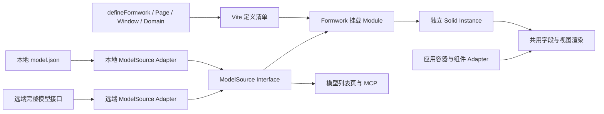
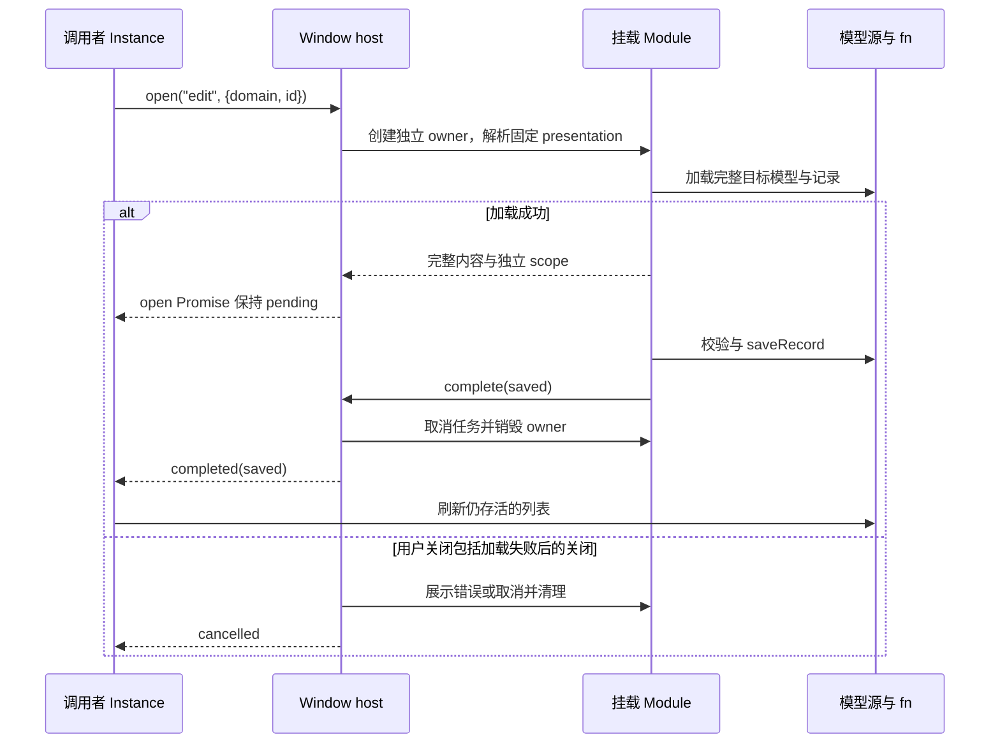
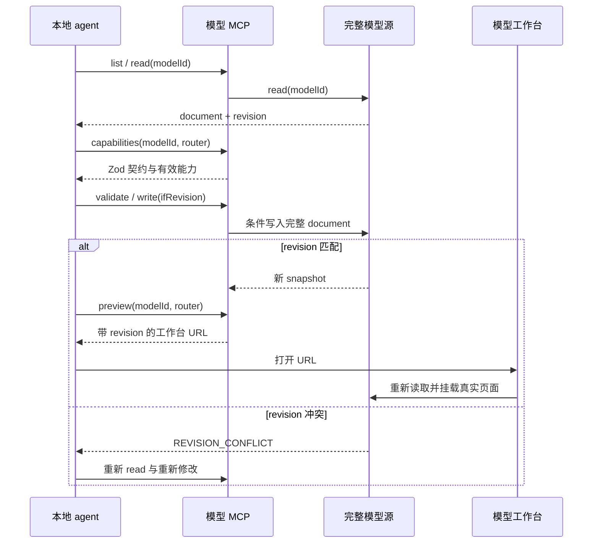

# Formwork 定义与运行机制设计

推荐将公开定义固定为 `defineFormwork → definePage / defineWindow → 可选 defineDomain`。Page 汇集页面行为与渲染配置，Model 提供数据描述和可选视图，Domain 提供稀疏覆盖；一次挂载创建一个 Solid Instance。共用渲染、表达式、字段状态和资源清理集中在 `packages/formwork` 的 Implementation 中。[Expert judgment]

用户已确认上述方向、Solid-only、可信 `{{ }}`、全新 schema、模型稳定 `id`、默认视图、静态 Window 展示方式与 MCP 的职责。[Data-backed] 文中的首版 Interface 与应用迁移已于 2026-10-29 实现并经真实工具链验收；阶段 0–7 的启动与结果见 [开发与验收说明](./formwork-development.md)。独立开发 HTTP 服务已联通，生产后端与发布流程仍是后续范围。下文作为契约和设计依据保留，示例名称与实际文件组织可能不同。

| 文档属性 | 本轮范围                                               |
| -------- | ------------------------------------------------------ |
| 类型     | 概要设计与 Interface 详细设计                          |
| 系统阶段 | 基于现有源码的重构，协议重新设计                       |
| 读者     | 框架维护者、应用作者、模型作者                         |
| 依据     | 已确认访谈与 [源码分析](./formwork-source-analysis.md) |
| 交付     | 定义契约、完整使用链路、包职责、迁移次序与行为验收     |

## 1 定义分别拥有哪项信息

同一个模型可以被 list、edit、detail 页面访问；同一个 list 定义也可以访问任意模型。页面定义清单与模型目录因此独立，`domains` 不参与枚举模型。[Expert judgment]

| 概念     | 唯一职责             | 不变量                                        |
| -------- | -------------------- | --------------------------------------------- |
| Formwork | 装配应用的共同能力   | 不保存某次页面的值、选择或请求结果            |
| Page     | 声明可寻址的内容     | `router` 是定义名；`path` 是 URL 模式         |
| Window   | 声明带完成结果的内容 | 与 Page 使用同一挂载过程；`presentation` 固定 |
| Domain   | 覆盖指定模型的能力   | key 等于模型 `id`；没有独立生命周期           |
| Model    | 保存可编辑的业务描述 | `{ id, title, data, views? }`；不包含代码定义 |
| Instance | 持有一次挂载的状态   | 独立 owner、scope、请求和清理过程             |
| Field    | 绑定一个业务值位置   | 数组项身份不随索引移动而改变                  |
| View     | 描述组件与布局       | 布局节点不产生业务值                          |

`Module` 指拥有 Interface 和 Implementation 的模块；`Seam` 是替换实现的位置；`Adapter` 是满足该 Interface 的具体实现。这里的 Depth 来自一次定义隐藏多少装配工作，Locality 来自一次修复能影响多少调用处。[Expert judgment]

图 1　页面定义与模型源在一次挂载中汇合



Vite 处理静态代码和本地模型文件；ModelSource 提供模型目录与内容；挂载 Module 负责把路由、有效定义和模型组合成 Instance。UI Adapter 只依赖公开的字段与渲染契约。源码中的多次编译、scope 拼接和 Overlay 表单提取都在这一组合过程中收敛。[Expert judgment]

| Module     | 对外 Interface                      | Implementation 隐藏的工作                   | 依赖策略                      |
| ---------- | ----------------------------------- | ------------------------------------------- | ----------------------------- |
| 定义与挂载 | `define*`、`app.render`、`ctx.open` | 覆盖解析、路由、加载、owner、完成与销毁     | 进程内；容器由应用注入        |
| 字段与视图 | `ctx.Render`、`ctx.createScope`     | 默认视图、字段绑定、表达式、校验、数组身份  | 进程内；UI Adapter 由应用提供 |
| 模型源     | `list / read / write`               | 文件或 HTTP 传输、revision、完整性          | 本地与远端两个真实 Adapter    |
| Vite 插件  | `formworkPlugin`、虚拟模块          | 文件发现、延迟导入、诊断、HMR、本地工具承载 | 本地依赖，可用临时项目验证    |
| 模型工具   | MCP 的六项操作                      | 能力汇总、源写入与预览定位                  | 复用模型源与验证逻辑          |

## 2 模型只保存业务数据与可选视图

模型 `id` 使用 `^[a-z][a-z0-9_-]*$`，区分大小写的歧义通过只允许小写消除；`orders` 同时是目录键、URL 中的 domain、`ctx.domain` 与 MCP `modelId`。id 创建后不原地重命名，title 可以修改。记录 id 是另一项输入，不使用模型 id 的命名规则。[Expert judgment]

### 2.1 DataSchema 的第一版范围

`data` 使用 JSON Schema 子集。字段名直接来自 `properties`，必填来自 `required`，枚举来自 `enum`；不重复保存一份 fields/form 列表。字段改名视为删除与新增；物理数据库的迁移身份留给后端设计，不把旧字段 id 混入新渲染协议。[Expert judgment]

| 支持项       | 解释                                                                |
| ------------ | ------------------------------------------------------------------- |
| 值类型       | `string`、`number`、`integer`、`boolean`、`null`、`object`、`array` |
| 对象与数组   | `properties`、`required`、`items`；对象默认不允许未声明字段         |
| 描述与默认值 | `title`、`description`、`default`、`readOnly`                       |
| 约束         | `enum`、字符串长度与 pattern、数值范围、数组长度                    |
| 空值         | 标量 `type: ["string", "null"]` 等可空形式                          |
| 复用         | 根 `data.$defs` 与指向 `#/$defs/...` 的本地 `$ref`                  |
| 暂不支持     | 外部 `$ref`、任意组合的 `oneOf/anyOf`、存储 DDL、关系查询协议       |

这份子集足以生成默认视图，同时控制首版解释器的范围。收到未支持的关键字时返回 schema 诊断，不静默忽略。`default` 只在创建可编辑 scope 时补入缺失值；不会覆盖显式传入的 `null`、`false`、`0` 或空字符串。[Expert judgment]

以下是拟议类型声明，JSDoc 同时约束调用行为。[Expert judgment]

```ts
import type { Accessor, Component, JSX } from "solid-js";
import type { z } from "zod";

/** 表示模型文件可以保存的 JSON 值。 */
export type JsonValue =
  | string
  | number
  | boolean
  | null
  | JsonValue[]
  | { [key: string]: JsonValue };

type Scalar = string | number | boolean | null;
type Nullable<T extends string> = T | readonly [T, "null"];
type SchemaMetadata = {
  title?: string;
  description?: string;
  default?: JsonValue;
  readOnly?: boolean;
};

/** 描述业务值；本地 $ref 以根 data 为解析基准。 */
export type DataSchema = SchemaMetadata &
  (
    | {
        type: Nullable<"string">;
        enum?: readonly Scalar[];
        minLength?: number;
        maxLength?: number;
        pattern?: string;
      }
    | {
        type: Nullable<"number" | "integer">;
        enum?: readonly Scalar[];
        minimum?: number;
        maximum?: number;
      }
    | { type: Nullable<"boolean">; enum?: readonly Scalar[] }
    | { type: "null" }
    | ObjectSchema
    | { type: "array"; items: DataSchema; minItems?: number; maxItems?: number }
    | { $ref: string }
  );

/** 描述一组具名字段，properties 的枚举顺序也是默认展示顺序。 */
export type ObjectSchema = {
  type: "object";
  properties: Record<string, DataSchema>;
  required?: readonly string[];
  additionalProperties?: false;
};

/** 描述组件树；field 是相对当前值根的 JSON Pointer，例如 /customer/name。 */
export type ViewNode = {
  component: string;
  field?: string;
  props?: Record<string, JsonValue>;
  bindings?: {
    value?: string;
    readOnly?: boolean | string;
    disabled?: boolean | string;
    visible?: boolean | string;
  };
  children?: readonly ViewNode[];
};

/** 保存一个模型的完整业务描述，不包含 revision 或源位置。 */
export type ModelDocument = {
  id: string;
  title: string;
  data: ObjectSchema & SchemaMetadata & { $defs?: Record<string, DataSchema> };
  views?: Record<string, ViewNode>;
};

/** 校验完整模型的最小结构及字段引用，不包含 UI 或存储依赖。 */
export declare const modelDocumentSchema: z.ZodType<ModelDocument>;
```

`DataSchema` 的 TypeScript 类型不是完整校验器。实际 `modelDocumentSchema` 必须校验 required 引用、enum 值类型、约束范围、default、可解析的 `$ref` 及根对象限制。`$ref` 循环在第一版报错；同一 schema 可以反复引用，不能因此复用可变字段状态。[Expert judgment]

### 2.2 自动视图与定制视图

没有 `views[router]` 时，渲染器按 `data` 生成组件树。根由当前 container 承载，字段由当前 fieldContainer 包裹；字段组件按下表选择。表单、筛选和表格使用同一选择规则，值是否可编辑来自 scope。[Expert judgment]

| DataSchema       | 默认组件 key  |
| ---------------- | ------------- |
| 有 enum 的标量   | `Select`      |
| string           | `Input`       |
| number / integer | `NumberInput` |
| boolean          | `Switch`      |
| object           | `Object`      |
| array            | `Array`       |
| null             | `Null`        |

`views[router]` 是该页面的完整可选视图替换，不做按数组索引深合并。绑定对象字段的节点可以省略 children，继续生成该对象的默认子字段；显式 children 则完整决定该节点的子视图。没有 field 的节点只是布局或动作。`props` 不得覆盖 `value/onChange/readOnly/disabled/errors/schema/array` 等绑定保留属性。[Expert judgment]

```json
{
  "id": "orders",
  "title": "订单",
  "data": {
    "type": "object",
    "properties": {
      "id": { "type": "string", "title": "记录 ID", "readOnly": true },
      "orderNo": { "type": "string", "title": "订单号", "minLength": 1 },
      "status": {
        "type": "string",
        "title": "状态",
        "enum": ["pending", "paid"],
        "default": "pending"
      },
      "paid": { "type": "boolean", "title": "已付款", "default": false },
      "amount": { "type": "number", "title": "金额", "minimum": 0 },
      "lines": {
        "type": "array",
        "title": "明细",
        "items": {
          "type": "object",
          "properties": {
            "sku": { "type": "string", "title": "SKU" },
            "quantity": { "type": "integer", "title": "数量", "minimum": 1 }
          },
          "required": ["sku", "quantity"]
        }
      }
    },
    "required": ["orderNo", "status"]
  }
}
```

该 orders 文档不需要 views 或 orders Domain 就能被所有默认页面使用。另一个 cms 模型可以把 edit 的内容字段定制为富文本，并保留其他字段自动生成。[Expert judgment]

```json
{
  "id": "cms",
  "title": "内容",
  "data": {
    "type": "object",
    "properties": {
      "id": { "type": "string", "readOnly": true },
      "title": { "type": "string", "title": "标题", "minLength": 1 },
      "content": { "type": "string", "title": "正文" }
    },
    "required": ["title"]
  },
  "views": {
    "edit": {
      "component": "Object",
      "field": "",
      "children": [
        { "component": "Input", "field": "/title" },
        { "component": "RichText", "field": "/content" }
      ]
    }
  }
}
```

## 3 定义覆盖与寻址使用确定规则

`router` 在 Formwork 的 pages/windows 清单中唯一，使用与模型 id 相同的单段小写标识规则。普通页面默认 `path = "/" + router`；schema 页面显式提供含 `:domain` 的 path，避免通过 getSchema 推断路径。`path` 支持固定段、`:param` 与末尾的 `:param?`；参数按段编码和解码，首版不支持通配与自定义正则。重复或同优先级歧义路径在构建时失败。[Expert judgment]

| 定义        | router | path                  | 实际访问                    |
| ----------- | ------ | --------------------- | --------------------------- |
| 普通首页    | home   | 默认 `/home`          | `/home`                     |
| 模型工作台  | models | `/models/:domain?`    | `/models`、`/models/orders` |
| 动态列表    | list   | `/list/:domain`       | `/list/orders`、`/list/cms` |
| 新建 Window | add    | `/add/:domain`        | `/add/orders`               |
| 编辑 Window | edit   | `/edit/:domain/:id`   | `/edit/orders/record-1`     |
| 详情 Window | detail | `/detail/:domain/:id` | `/detail/orders/record-1`   |

schema 页要求 URL 的 domain 与最终校验文档的 id 完全一致。代码跳转使用 `navigate(router, params)` 或 `open(router, params)`，框架填充并编码 path 参数；未知 router、缺少参数和非法 domain 都产生定位明确的错误。[Expert judgment]

### 3.1 覆盖是按名称替换

Formwork 默认 → Page/Window → 匹配的 Domain → 本次 Render 的局部配置，形成从远到近的覆盖次序。components 和 fn 按名称浅合并；同名后者替换，未声明项保留。container、fieldContainer、getSchema、schema 是整项替换；禁止把运行时状态对象放入静态定义。[Expert judgment]

| 事项               | 首版规则                                                     |
| ------------------ | ------------------------------------------------------------ |
| Domain 加载        | `domains[id]` 可为 defineDomain 返回值或 `() => import(...)` |
| Domain 适用范围    | 只影响引用它的 Page/Window；可以显式复用同一个 domains 对象  |
| 未声明的 Domain    | 正常使用默认能力；不尝试猜测文件路径                         |
| 已声明但加载失败   | 当前挂载报错，禁止静默回退                                   |
| schema 就近定义    | 选最靠近当前模型的 getSchema 与 schema；两者分别覆盖         |
| 没有 getSchema     | 调用 `ctx.models.read(ctx.domain)` 取 document               |
| 校验               | 最小结构校验 → 有效 Zod schema → 最小结构与 id 再校验        |
| 组件能力校验       | 完成 Domain 加载后，检查有效 View 所引用的 key               |
| 本地模型与覆盖共存 | model.json 与对应 Domain 文件可以放在同一目录                |

Zod 可以做 refinement 或归一化，但不能绕过最小模型契约。校验后的运行时文档与完整源是两项数据，运行时归一化结果不会自动写回模型源。模型列表与 MCP 校验待写入的原文，并保存完整原文。[Expert judgment]

### 3.2 define* 的类型与输入

下列声明省略实现；`ComponentRegistry` 中的 any 只出现在异构组件的动态查找位置。字段组件仍遵守第 4 节的 FieldProps 契约。[Expert judgment]

```ts
/** 注册异构 UI Adapter；名称在有效 View 中可寻址。 */
export type ComponentRegistry = Record<string, Component<any>>;
type BoundFn = Record<string, (...args: any[]) => any>;
type FnRegistry = Record<string, (ctx: ActionContext, ...args: any[]) => unknown>;
type Params = Readonly<Record<string, string>>;
type RouteParams = Readonly<Record<string, string | undefined>>;

/** 返回 Window 的一次终态；取消与成功都有明确结果。 */
export type WindowOutcome = { status: "completed"; value: unknown } | { status: "cancelled" };

/** 为一次行为调用提供上下文；signal 随当前 Instance 的销毁取消。 */
export type ActionContext = {
  domain?: string;
  params: RouteParams;
  model?: ModelDocument;
  models: ModelSource;
  signal: AbortSignal;
  fn: BoundFn;
  navigate: (router: string, params?: Params) => void;
  open: (router: string, params?: Params) => Promise<WindowOutcome>;
  complete: (value: unknown) => void;
};

/** 加载 schema 页的模型；domain 已经通过 URL 规则校验。 */
export type LoadContext = ActionContext & { domain: string };

type RenderDefaults = {
  container?: Component<PageContext>;
  fieldContainer?: Component<FieldContainerProps>;
  components?: ComponentRegistry;
  fn?: FnRegistry;
  schema?: z.ZodType<ModelDocument>;
  getSchema?: (ctx: LoadContext) => unknown | Promise<unknown>;
};

/** 声明指定模型的稀疏覆盖，本身不会创建 Instance。 */
export type DomainDefinition = RenderDefaults;
type DomainModule = { default: DomainDefinition };
type Domains = Record<string, DomainDefinition | (() => Promise<DomainModule>)>;

type DefinitionBase = {
  router: string;
  path?: string;
  components?: ComponentRegistry;
  fn?: FnRegistry;
  domains?: Domains;
};
type SchemaBody = RenderDefaults & { render?: never };
type PlainBody = {
  render: Component<ActionContext>;
  schema?: never;
  getSchema?: never;
  container?: never;
  fieldContainer?: never;
};

/** 声明普通 Solid 内容或由模型驱动的内容，两种形式互斥。 */
export type PageDefinition = DefinitionBase & (SchemaBody | PlainBody);

/** 接受插件作者语法；JSX 字面量必须在 JSX 编译前被转换为挂载工厂。 */
export type PageAuthorDefinition = DefinitionBase &
  (SchemaBody | (Omit<PlainBody, "render"> & { render: Component<ActionContext> | JSX.Element }));

/** 固定 Window 的承载形态，调用 open 时不能改写。 */
export type WindowDefinition = PageDefinition & {
  presentation: "page" | "modal" | "drawer";
  returnTo: string;
};

/** 为普通内容 Window 提供相同的插件作者语法。 */
export type WindowAuthorDefinition = PageAuthorDefinition & {
  presentation: "page" | "modal" | "drawer";
  returnTo: string;
};

/** 在正确 Solid owner 内挂载内容；close 触发当前 Instance 的取消终态。 */
export type PresenterProps = {
  children?: JSX.Element;
  direct: boolean;
  close: () => void;
};

/** 装配静态定义；models 为模型列表、默认加载与模型工具提供同一个源。 */
export type FormworkDefinition = RenderDefaults & {
  models: ModelSource;
  pages: readonly PageDefinition[];
  windows?: readonly WindowDefinition[];
  presenters: {
    page: Component<PresenterProps>;
    modal?: Component<PresenterProps>;
    drawer?: Component<PresenterProps>;
  };
};

/** 在当前 Solid owner 下创建 Router 与 Window host，每次调用状态独立。 */
export type FormworkApplication = {
  render: Component;
};

/** 保存应用定义，调用时不执行请求、不创建字段状态或页面 owner。 */
export declare function defineFormwork(definition: FormworkDefinition): FormworkApplication;

/** 保存一个可寻址页面定义，实际状态在挂载时创建。 */
export declare function definePage(
  definition: PageDefinition | PageAuthorDefinition,
): PageDefinition;

/** 保存固定承载形态的 Window 定义。 */
export declare function defineWindow(
  definition: WindowDefinition | WindowAuthorDefinition,
): WindowDefinition;

/** 保存指定模型的覆盖项，不枚举或注册模型。 */
export declare function defineDomain(definition: DomainDefinition): DomainDefinition;
```

`schema` 默认使用 formwork 导出的 `modelDocumentSchema`；schema 内容的 container 可以从 Formwork 继承。普通 render 只继承 components/fn 等共同能力，不触发模型加载。缺少必要 container/presenter 的定义应在静态可判定时构建失败，动态覆盖场景在创建内容前报错。[Expert judgment]

## 4 模型源提供完整文档与并发写入契约

ModelSource 的三个操作足以支撑目录、运行时默认加载、MCP 编辑和上传。revision 与源位置放在返回 envelope 中，避免把文件版本、HTTP 版本和模型数据混在一起；revision 是不透明字符串，调用者只做相等比较。[Expert judgment]

local.path 使用相对项目根的源路径；MCP 根据自己的项目根解析，构建产物里的 path 仅表示来源，不表示浏览器所在机器的文件。remote.uri 是完整管理源的定位信息，实际访问与认证由 Adapter 处理。[Expert judgment]

```ts
/** 标识完整模型的实际来源；远端 uri 是管理源定位信息。 */
export type ModelLocation = { kind: "local"; path: string } | { kind: "remote"; uri: string };

/** 描述目录中的一个模型，id 必须与 read 返回的 document.id 一致。 */
export type ModelEntry = {
  id: string;
  title: string;
  revision: string;
  location: ModelLocation;
  writable: boolean;
};

/** 返回完整管理源；运行时权限投影不能满足这一契约。 */
export type ModelSnapshot = ModelEntry & {
  document: ModelDocument;
  completeness: "full";
};

type ReadOptions = { signal?: AbortSignal };
type WriteOptions = ReadOptions & {
  /** null 表示仅创建；更新必须传最近一次 read 的 revision。 */
  ifRevision: string | null;
};

/** 为模型目录、完整读取和有条件写入提供同一个 Seam。 */
export type ModelSource = {
  list: (options?: ReadOptions) => Promise<readonly ModelEntry[]>;
  read: (modelId: string, options?: ReadOptions) => Promise<ModelSnapshot>;
  write: (document: ModelDocument, options: WriteOptions) => Promise<ModelSnapshot>;
};
```

| 操作             | 成功语义                                      | 失败语义                                 |
| ---------------- | --------------------------------------------- | ---------------------------------------- |
| list             | 仅枚举该源真正拥有的完整模型；以 id 排序      | 源不可用时失败，不将 domains 冒充目录    |
| read             | 返回同一 revision 下的完整 document 与元信息  | 不存在 `NOT_FOUND`；权限不足 `FORBIDDEN` |
| write 创建       | `ifRevision: null`，id 不存在时写入           | 已存在 `REVISION_CONFLICT`               |
| write 更新       | 当前 revision 匹配后完整替换，返回新 revision | 不匹配 `REVISION_CONFLICT`，保留已有文档 |
| 只读源写入       | 无写入                                        | `READ_ONLY`                              |
| 校验或提交前取消 | 无写入                                        | `INVALID_MODEL` 或 `ABORTED`             |

文件 Adapter 在自己的写入锁内检查 revision、写临时文件并原子替换；若使用者同时允许外部编辑器直接写文件，还需比较内容 revision 并报告竞争，不能声称单靠 rename 已解决外部并发。远端 Adapter 将条件写入交给服务器原子处理。source 自己维护身份与版本的一致性。[Expert judgment]

提交后遇到网络中断，调用者可能无法判断写入是否成功；此时先 read 核对 revision 与文档，再决定下一次 write。取消 signal 不承诺撤销已经提交的写入，框架不自动重试写操作。[Expert judgment]

| Adapter      | 首版职责                                                                                      |
| ------------ | --------------------------------------------------------------------------------------------- |
| 本地开发     | Vite 插件发现 model.json；浏览器代理到 dev server，MCP 直接复用同一源；验证后写文件并触发 HMR |
| 本地构建产物 | 从打包的 JSON 读取完整模型；稳定内容 revision；write 返回 READ_ONLY                           |
| 远端         | 应用提供 HTTP 实现；认证、管理权限、完整源读取与条件写入由应用和服务端承担                    |

schema 可以与 Domain 就近放置，例如 `domains/cms/model.json` 与 `domains/cms/index.tsx`。没有私域代码的模型只保留 `models/orders/model.json`。同一个 ModelSource 内重复 id 是错误；拼接多个源时，应用必须确定每个 id 的唯一所有者，框架不做“本地失败就去远端”的隐式回退。[Expert judgment]

上传是读取本地完整源、读取远端 revision、调用远端 write 的显式行为；它不切换当前来源，也不修改数据库表。保存模型文档与后端发布/迁移拥有不同结果，第一版不提供 publish 的假实现。[Expert judgment]

## 5 共用渲染以显式 scope 接入容器

Render 是 Instance 提供的 Solid Component，不是另一个 define 工厂。普通表单直接使用 Page 默认 children；List 通过相同 Render 挂载筛选字段与表格单元格。只有需要独立值集合的容器创建 scope，多个 scope 共享描述、隔离状态。[Expert judgment]

### 5.1 三种 Interface 的取舍

最小入口方案返回可执行 View 闭包，并附带列 slot；灵活方案拆开 Context、Binding 与惰性 Slot，调用方自由装配；默认优先方案用宿主 context 隐式决定 draft/row，Table 把字段声明收集为列模板。这三种方案均保留既定 define* 层级。[Expert judgment]

| 方案                      | 代表调用                                                   | Depth 与 Locality                        | 代价                                                          |
| ------------------------- | ---------------------------------------------------------- | ---------------------------------------- | ------------------------------------------------------------- |
| A 可执行 View 闭包        | `fields(local)(draft)`、`view.slots[i](row)`               | 编译、绑定和配置被闭包捕获，字段规则集中 | 调用者仍需理解 slot 元信息与目标值根                          |
| B Context 与 Binding/Slot | `bind(lens)`、`<Slot binding={row} />`                     | 复杂视图最自由；状态与呈现独立复用       | 默认调用需要更多装配与绑定选项，容易扩大概念数量              |
| C 隐式宿主与 Fields       | `<Filter><Fields /></Filter>`、`<Table><Fields /></Table>` | 普通调用最短；宿主 Adapter 承担投影      | 隐式 scope 和列注册顺序成为额外 Interface，Table 宿主协议较重 |

推荐收敛为显式 scope 与 `<Render />`：采用 A 的上下文闭包，保留 B 的显式值根，采用 C 的声明式调用，但不公开 slot/lens 或宿主查询通道。调用者能明确当前值来自筛选草稿还是某一行；计划与 binding 留作 Implementation，普通页面默认使用惰性 children，不公开第二个 Fields 入口。[Expert judgment]

Page.container 接收 PageContext，负责整页外壳；Render.container 替换本次视图的根容器，只接收 children。Page.container 不向内层 Render 继承，避免递归挂载自己；内层未传 container 时使用 View 的根组件。components 与 fieldContainer 继续继承。fieldContainer 包裹单个字段，可分别适配 FormItem、FilterItem、TableCell；对象值根不额外包一个字段容器。[Expert judgment]

### 5.2 scope 与字段组件的契约

```ts
/** 定位业务值校验问题，path 使用当前 scope 内的 JSON Pointer。 */
export type ValidationIssue = { path: string; code: string; message: string };

/** stale 表示该次校验已被新值、新校验或销毁淘汰。 */
export type ValidationResult = {
  status: "valid" | "invalid" | "stale";
  issues: readonly ValidationIssue[];
};

/** 操作稳定身份的数组项；move 不重建项的 scope 或 UI 实例。 */
export type ArrayHandle = {
  items: Accessor<readonly { key: string; scope: ValueScope }[]>;
  insert: (index: number, value?: JsonValue) => string;
  remove: (key: string) => void;
  move: (key: string, index: number) => void;
};

/**
 * 持有一个独立值根；reset 装载数据，set 编辑字段。
 * value 返回独立的普通 JSON 快照，可序列化或复制，不暴露响应式代理。
 */
export type ValueScope = {
  value: Accessor<JsonValue | undefined>;
  errors: Accessor<readonly ValidationIssue[]>;
  set: (pointer: string, value: JsonValue | undefined) => void;
  reset: (value?: JsonValue) => void;
  validate: () => Promise<ValidationResult>;
  array: (pointer: string) => ArrayHandle;
};

/** 创建当前 owner 下的值集合；defaults:false 适用于筛选草稿和已有记录。 */
export type ScopeOptions = {
  schema?: DataSchema;
  value?: JsonValue;
  defaults?: boolean;
  readOnly?: boolean;
  validate?: (
    value: JsonValue | undefined,
    context: { signal: AbortSignal },
  ) => readonly ValidationIssue[] | Promise<readonly ValidationIssue[]>;
};

/** 包裹一次渲染的内容，不拥有额外字段值。 */
export type ContainerProps = { children?: JSX.Element };

/** 为字段提供标签和错误呈现；children 是已经绑定的值组件。 */
export type FieldContainerProps = ContainerProps & {
  path: string;
  title: string;
  required: boolean;
  errors: readonly ValidationIssue[];
};

/** 为值组件提供统一绑定；只读字段的 onChange 会拒绝写入。 */
export type FieldProps = ContainerProps & {
  value: JsonValue | undefined;
  onChange: (value: JsonValue | undefined) => void;
  readOnly: boolean;
  disabled: boolean;
  errors: readonly ValidationIssue[];
  schema: DataSchema;
  array?: ArrayHandle;
  Item?: Component<{ scope: ValueScope }>;
};

type RenderOverrides = {
  scope?: ValueScope;
  container?: Component<ContainerProps>;
  fieldContainer?: Component<FieldContainerProps>;
  components?: ComponentRegistry;
};

/** 渲染默认树、指定视图或单个字段；field 与 view 不能同时提供。 */
export type RenderProps = RenderOverrides &
  ({ field: string; view?: never } | { view?: ViewNode; field?: never });

/** 向 schema 内容提供共享渲染与独立值集合的两个入口。 */
export type PageContext = LoadContext &
  ContainerProps & {
    model: ModelDocument;
    scope: ValueScope;
    Render: Component<RenderProps>;
    createScope: (options?: ScopeOptions) => ValueScope;
  };
```

| 调用或状态    | 不变量                                                                                                                         |
| ------------- | ------------------------------------------------------------------------------------------------------------------------------ |
| createScope   | 必须在 Instance 的 Solid owner 或其后代 owner 下调用；卸载自动销毁                                                             |
| 默认 scope    | 使用 model.data；第一次读取时创建，避免 List 无用地生成一份表单状态                                                            |
| 默认 Render   | 不传 scope/view/field 时使用 Page scope 与 views[router]，未定义则自动生成                                                     |
| 显式 scope    | 默认生成该 scope 的字段树；需要定制时显式传 view                                                                               |
| 单字段 Render | field 在传入 scope 内解析；不继承页面的整棵定制视图                                                                            |
| 指定 view     | 相对传入 scope 的 schema/value 根解析 field；不存在路径报配置错误                                                              |
| set/reset     | set 的 undefined 删除对象属性；reset(value) 以给定值重新建立状态，不补默认值；reset() 恢复初始值策略；两者清除旧校验与异步任务 |
| readonly      | `scope.readOnly                                                                                                                |     | schema.readOnly`；UI 显示由组件处理，写入由 scope 拒绝 |
| validate      | 先 DataSchema 校验，再可选异步 validate；只有最新且仍存活的结果更新 errors                                                     |
| 数组身份      | insert 生成实例内 key，move 保留 key，remove 清理对应项 owner；key 不写入 JSON                                                 |
| 字段 props    | 响应式 getter 在组件读取时求值，Adapter 不应通过提前解构丢失响应性                                                             |
| 稳定描述      | 同一模型版本的规范化 schema 和表达式程序可以缓存；scope 与数组 key 不进缓存                                                    |

array 的 item scope 自成值根，item View 的 `/sku` 指向该项的 sku。错误向外汇总时按最新索引形成 `/lines/2/sku`；内部身份仍是稳定 key。移动数组项不会把该项的异步校验结果写到原索引的新项。[Expert judgment]

`Array` Adapter 使用 array.items 的稳定 key 循环，并在对应 item owner 中挂载 `Item`。Item 是当前 Render 提供的惰性子内容，继承本次有效的视图与组件配置；array 保存值，不保存 JSX。Table 的记录行则按业务记录 id 建立 owner；记录 id 缺失或重复时，Table Adapter 报数据错误，不回退索引。[Expert judgment]

UI 组件可以读取 `schema.enum`；把 Switch 替换为 Select 时，Select 必须保留布尔值和 undefined，不能把 `"false"` 当作 false。Input 在 readOnly 下显示文本、Array 在 readOnly 下显示明细等行为属于应用 Adapter。框架不会按 Form/Filter/Table 注入隐藏 mode。[Expert judgment]

## 6 一套定义覆盖默认模型与私域模型

下面按预期文件组织展示完整装配。代码是 Interface 使用示例，UI 和请求函数由 `apps/client` 实现；未假设仓库已有这些新文件或某个远端 HTTP 路径。orders/cms 的 model.json 使用第 2 节内容。[Expert judgment]

### 6.1 Formwork 与普通页面

```tsx
// apps/client/src/formwork.tsx
import { defineFormwork, definePage, defineWindow } from "formwork";
import models from "virtual:formwork/models";
import {
  Input,
  NumberInput,
  Select,
  Switch,
  ObjectFields,
  ArrayFields,
  NullValue,
  FormShell,
  FormItem,
  PagePresenter,
  ModalPresenter,
  DrawerPresenter,
  Home,
} from "./ui";
import { List } from "./pages/list-content";
import { RecordEditor, RecordDetail } from "./pages/record-content";
import { ModelWorkbench } from "./pages/model-workbench";
import * as recordFns from "./fn/records";

const domains = { cms: () => import("./domains/cms") };

const home = definePage({
  router: "home",
  render: () => <Home />,
});

const modelsPage = definePage({
  router: "models",
  path: "/models/:domain?",
  render: ModelWorkbench,
});

const list = definePage({
  router: "list",
  path: "/list/:domain",
  container: List,
  domains,
});

const add = defineWindow({
  router: "add",
  path: "/add/:domain",
  presentation: "modal",
  returnTo: "list",
  container: RecordEditor,
  domains,
});

const edit = defineWindow({
  router: "edit",
  path: "/edit/:domain/:id",
  presentation: "drawer",
  returnTo: "list",
  container: RecordEditor,
  domains,
});

const detail = defineWindow({
  router: "detail",
  path: "/detail/:domain/:id",
  presentation: "drawer",
  returnTo: "list",
  container: RecordDetail,
  domains,
});

/** 组合默认模型页面与普通页面，由 app.render 创建实际实例。 */
export default defineFormwork({
  models,
  components: {
    Input,
    NumberInput,
    Select,
    Switch,
    Object: ObjectFields,
    Array: ArrayFields,
    Null: NullValue,
  },
  container: FormShell,
  fieldContainer: FormItem,
  fn: recordFns,
  pages: [home, modelsPage, list],
  windows: [add, edit, detail],
  presenters: {
    page: PagePresenter,
    modal: ModalPresenter,
    drawer: DrawerPresenter,
  },
});
```

应用入口在 Solid `render` 的回调内调用 `app.render`。`render: () => <Home />` 为每次挂载创建内容；字面量 `render: <Home />` 只在启用 Vite 插件且可静态识别时被转换为延迟工厂。PageAuthorDefinition 允许这种作者语法，运行时只接受已转换的函数；不用插件时使用工厂。[Expert judgment]

所有 schema 内容继承默认模型源和模型校验器。只有访问 cms 时加载私域模块；orders 无须任何注册代码。请求、工具与行为放在一个 fn 空间，函数实现的首参接收 ActionContext，`ctx.fn.name(...args)` 和表达式 `fn.name(...args)` 都由框架绑定首参。[Expert judgment]

`BoundFn` 是动态名称查找处的类型擦除，不保证业务参数与返回值的静态类型。应用代码可以给 ctx.fn 叠加自己的绑定函数类型；MCP 能力查询则读取函数名称、声明和 JSDoc。框架不再拆成 service/util/enum 四套注册；静态枚举直接保存在 data.enum，复杂选项用 fn 获取。[Expert judgment]

### 6.2 List 同时挂载 Filter 与 Table

```tsx
// apps/client/src/pages/list-content.tsx
import { createResource, createSignal } from "solid-js";
import type { Component } from "solid-js";
import type { JsonValue, PageContext } from "formwork";
import {
  ListShell,
  FilterShell,
  FilterItem,
  TableShell,
  TableRow,
  TableCell,
  BooleanFilter,
  ReadText,
  ReadBoolean,
  ReadObject,
  ReadArray,
} from "../ui";
import { makeQuerySchema } from "../fn/query-schema";

type RecordValue = { id: string; [key: string]: JsonValue };

/** 将筛选草稿与记录行接入同一个 Render，不复制字段渲染规则。 */
export const List: Component<PageContext> = (ctx) => {
  const Render = ctx.Render;
  const draft = ctx.createScope({
    schema: makeQuerySchema(ctx.model.data),
    defaults: false,
  });
  const [query, setQuery] = createSignal<JsonValue>({});
  const [rows, { refetch }] = createResource(
    query,
    async (value) => (await ctx.fn.loadRecords(value)) as RecordValue[],
  );

  const openRecord = async (router: string, id?: string) => {
    const params: Record<string, string> = { domain: ctx.domain };
    if (id) params.id = id;
    const outcome = await ctx.open(router, params);
    if (outcome.status === "completed") await refetch();
  };

  return (
    <ListShell>
      <Render
        scope={draft}
        view={ctx.model.views?.["list.filter"]}
        container={FilterShell}
        fieldContainer={FilterItem}
        components={{ Switch: BooleanFilter }}
      />
      <button
        onClick={async () => {
          if ((await draft.validate()).status === "valid")
            setQuery(structuredClone(draft.value() ?? {}));
        }}
      >
        查询
      </button>
      <button onClick={() => openRecord("add")}>新建</button>
      <TableShell
        rows={rows() ?? []}
        rowKey="id"
        columns={Object.keys(ctx.model.data.properties)}
        row={(record: RecordValue) => {
          const row = ctx.createScope({
            value: record,
            defaults: false,
            readOnly: true,
          });
          return (
            <TableRow>
              <Render
                scope={row}
                view={ctx.model.views?.["list.row"]}
                container={(props) => props.children}
                fieldContainer={TableCell}
                components={{
                  Input: ReadText,
                  NumberInput: ReadText,
                  Select: ReadText,
                  Switch: ReadBoolean,
                  Object: ReadObject,
                  Array: ReadArray,
                }}
              />
              <td>
                <button onClick={() => openRecord("edit", record.id)}>编辑</button>
                <button onClick={() => openRecord("detail", record.id)}>详情</button>
              </td>
            </TableRow>
          );
        }}
      />
    </ListShell>
  );
};
```

TableShell 在每个稳定记录 id 对应的 owner 下调用 row，维护分页、排序与选择；查询快照改变时重置页码。同一 id 的服务器更新通过行 Adapter 更新行数据或重新挂载该行，不能依赖一次回调捕获的旧对象。示例将分页 UI 与错误呈现交给 TableShell/ListShell，记录加载结果由 Solid resource 处理过期请求。[Expert judgment]

`makeQuerySchema` 是应用的查询策略：默认选可查询的标量，去掉 required/default/readOnly，保留值类型及适用约束。Filter 草稿的字段约束由这个投影校验，查询值如何转换为请求条件由 loadRecords 决定。它不产生另一份持久化的 Model schema，也不进入新的 define 层级。[Expert judgment]

自定义 Page.container 决定何时使用默认 children。List 自己组合两次 Render，因而显式读取可选的 `list.filter`、`list.row` 视图；这些只是应用选择的普通 view key，没有内核类型含义。未提供这两项时仍能完全自动生成字段。[Expert judgment]

Table 的复杂字段使用 ReadObject/ReadArray 显示摘要，不生成嵌套 td；需要展开明细时由对应 Adapter 在 item scope 下渲染。单元格独立定制也可以直接调用 `<Render scope={row} field="/status" />`，无须手动取得与绑定字段组件。[Expert judgment]

### 6.3 少数 Domain 替换组件与请求

```tsx
// apps/client/src/domains/cms/index.tsx
import { defineDomain } from "formwork";
import { RichText, CmsTitle } from "./components";
import { loadCmsRecords } from "./fn";
import { cmsDocumentSchema } from "./model.schema";

/** 为 cms 补充私域能力；model.json 与本定义位于同一目录。 */
export default defineDomain({
  schema: cmsDocumentSchema,
  components: { Input: CmsTitle, RichText },
  fn: { loadRecords: loadCmsRecords },
});
```

这里的 schema 仍是校验 getSchema 返回值的 Zod schema，不是 cms 的 data。Domain 也可以提供 `getSchema: async ctx => (await remoteModels.read(ctx.domain, { signal: ctx.signal })).document`，明确选择远端来源。目录仍来自 Formwork.models；若目录也需聚合远端内容，由应用 ModelSource Adapter 完成。[Expert judgment]

### 6.4 编辑与详情共享 Window 挂载机制

```tsx
// apps/client/src/pages/record-content.tsx
import { createResource } from "solid-js";
import type { Component } from "solid-js";
import type { PageContext } from "formwork";
import { FormShell, FormItem, DetailShell, DetailItem } from "../ui";

/** 为新建与编辑提供数据装载、校验、提交及 Window 完成结果。 */
export const RecordEditor: Component<PageContext> = (ctx) => {
  const Render = ctx.Render;
  const [record] = createResource(async () => {
    if (ctx.params.id) ctx.scope.reset(await ctx.fn.loadRecord());
    return true;
  });
  return (
    <FormShell ready={record()}>
      <Render fieldContainer={FormItem} />
      <button
        onClick={async () => {
          if ((await ctx.scope.validate()).status !== "valid") return;
          const saved = await ctx.fn.saveRecord(ctx.scope.value());
          ctx.complete(saved);
        }}
      >
        保存
      </button>
    </FormShell>
  );
};

/** 装载完整详情内容，由固定 drawer Presenter 承载。 */
export const RecordDetail: Component<PageContext> = (ctx) => {
  const Render = ctx.Render;
  const value = ctx.createScope({ readOnly: true, defaults: false });
  const [record] = createResource(async () => {
    value.reset(await ctx.fn.loadRecord());
    return true;
  });
  return (
    <DetailShell ready={record()}>
      <Render scope={value} view={ctx.model.views?.detail} fieldContainer={DetailItem} />
    </DetailShell>
  );
};
```

FormShell/DetailShell 的 ready 与错误呈现控制内容是否可操作；saveRecord 的提交态和重复提交防护由应用的提交控制提供。ctx.complete 只在 Window 中有效，普通 Page 调用报 `INVALID_OPERATION`。新建使用 data.default，编辑与详情用加载值 reset；不会在模块顶层共享表单实例。[Expert judgment]

### 6.5 模型列表是目录与预览工作台

```tsx
// apps/client/src/pages/model-workbench.tsx
import { createResource } from "solid-js";
import type { Component } from "solid-js";
import type { ActionContext } from "formwork";
import { WorkbenchShell, ModelPreview } from "../ui";

/** 从同一完整模型源列出模型，并定位选中模型的实际页面预览。 */
export const ModelWorkbench: Component<ActionContext> = (ctx) => {
  const [directory] = createResource(() => ctx.models.list({ signal: ctx.signal }));
  const [selected] = createResource(
    () => ctx.params.domain,
    (modelId) => ctx.models.read(modelId, { signal: ctx.signal }),
  );
  const previewRouter = new URLSearchParams(location.search).get("router") ?? "list";
  return (
    <WorkbenchShell
      entries={directory() ?? []}
      selected={selected()}
      onSelect={(domain: string) => ctx.navigate("models", { domain })}
    >
      <ModelPreview
        modelId={selected()?.id}
        router={previewRouter}
        revision={selected()?.revision}
      />
    </WorkbenchShell>
  );
};
```

ModelPreview 用实际 router/path 定位新 Instance，可以在工作台内用 iframe 展示实际页面；revision 变化时重新装载预览。路径与 query 改变重新创建工作台 Instance，避免沿用一次读取的旧路由值。模型选择、完整源和预览页面都以同一个 id 寻址。[Expert judgment]

MCP 返回预览 URL 后，本地 agent 可以自行打开页面检查。模型列表不需要先实现在线聊天代理、DOM 编辑器或通用截图回传协议；TypeScript/Solid 私域代码仍由本地文件工具修改。[Data-backed]

## 7 Instance 统一处理表达式与 Window 生命周期

定义函数只保存描述。挂载先创建用于加载的最小 owner 与 AbortController，解析匹配的 Domain，读取并校验模型，随后创建需要的 scope 与内容。失败的加载同样销毁临时 owner。静态定义、编译描述与运行实例因此有三种不同的寿命。[Expert judgment]

### 7.1 可信表达式只有一份上下文

| 名称      | 所指数据                                                    |
| --------- | ----------------------------------------------------------- |
| `$ctx`    | 当前行为上下文，包括 domain、params、navigate/open、signal  |
| `$model`  | 本次校验后的模型描述                                        |
| `$values` | 当前 Render scope 的值根；Filter 中是草稿，Table 中是记录行 |
| `$value`  | 当前绑定字段的值；布局节点中不存在                          |
| `$field`  | 当前字段定位与 schema；包含相对 scope 的 path               |
| `fn`      | 绑定当前上下文的有效函数                                    |

表达式只能引用实际存在的上下文；不存在的字段或函数产生带位置的诊断。Table 不额外拼 `$row`，读取记录 id 使用 `$values.id`，从而保留同一份字段计算规则。[Expert judgment]

`$values` 通过字段访问记录依赖，例如 `$values.lines` 订阅明细字段，不订阅整个 scope 快照。`scope.value()` 则返回普通 JSON 快照用于查询与提交；返回值不会与可变草稿共享对象引用，也不会把 Solid 代理传入 structuredClone 或请求序列化。[Expert judgment]

`props` 中完整匹配 `{{ ... }}` 的字符串按 JavaScript 表达式求值；普通字符串保持原样，混合字符串插值首版不支持。返回函数作为事件回调传给组件，不会在挂载时调用。返回 Promise 的普通属性只让该属性进入 pending；结果按最新求值轮次落地，失败保留最近有效值并报告错误。[Expert judgment]

```json
{
  "component": "Button",
  "props": {
    "title": "{{ $model.title }}",
    "onClick": "{{ () => fn.removeRecord($values.id) }}"
  }
}
```

`bindings` 明确声明写入字段值、只读、禁用和可见状态，避免 props 覆盖受控绑定。只有带 field 的节点可以声明 bindings.value；bindings.readOnly 只能增加只读限制，不能削弱 data.readOnly 或 scope 的只读限制。bindings.visible 控制视图，隐藏不会删除业务值或撤销 DataSchema 约束。[Expert judgment]

```json
{
  "component": "NumberInput",
  "field": "/amount",
  "bindings": {
    "value": "{{ fn.quote($values.lines) }}",
    "readOnly": true
  }
}
```

bindings.value 是显式的响应式写入：输入变化使旧 Promise 失效，字段删除/数组移动/Instance 销毁都按稳定字段身份核对结果。首版限制每个 scope/path 只有一个 value writer；重复 writer 报配置错误。运行时按实际字段读取建立 writer 依赖图，禁止直接自引用或 writer 间的环，写入前报告 `EXPRESSION_CYCLE`；动态依赖变化时重新检查，不用无限 createEffect 循环维持状态。[Expert judgment]

表达式配置可信，直接执行 JavaScript，不加入安全沙箱或额外授权。编译语法不在每个单元格重复运行；依赖跟踪和异步执行仍归当前 owner。语法错误可以提前发现，网络结果和业务行为仍需在真实运行时验证。[Data-backed / Expert judgment]

### 7.2 Window 始终挂载完整内容

图 2　打开、完成与关闭均经过同一个挂载过程



Host 只选择 Page/Modal/Drawer Presenter；数据装载、View、动作与字段容器来自完整目标定义，不提取某个 record-form 节点。加载失败时展示错误，open 仍等待用户关闭或重试；关闭后才返回 cancelled。重试复用同一窗口壳，重新创建内容 Instance。[Expert judgment]

| 情况                 | 固定行为                                                                  |
| -------------------- | ------------------------------------------------------------------------- |
| 同一 Window 打开两次 | 两个独立 Instance，不按 model/router 缓存可变状态                         |
| 调用 open            | 目标必须是 Window；调用者保持存活，URL 更新到目标 path                    |
| presentation 为 page | Host 暂时隐藏调用者内容，保留其 owner；完成后恢复                         |
| modal/drawer         | 背景是仍存活的调用者；直达 URL 时使用空的应用底层画布                     |
| URL 直达 Window      | 使用同一个 presentation；没有调用者也不切换为普通页面                     |
| returnTo             | 直达时完成/关闭后填充该 Page 的路径；使用当前 params 中所需的子集         |
| 浏览器返回           | 当前 Window 取消；恢复已有调用者，或走 returnTo                           |
| complete/close 竞争  | 第一次终态胜出，Promise 只结算一次                                        |
| 普通 navigate        | 切换根页面；销毁旧页面及其附属 Window，结算尚未结束的 open                |
| nested Window        | 子窗口独立 owner；销毁父窗口时先取消其子窗口                              |
| 销毁                 | 先标记不可写并取消任务，再执行全部 cleanup；单项 cleanup 失败不阻止其他项 |

`returnTo` 必须指向 definePage 注册的页面（可以是 schema 页，不能是 Window），且其必填 path 参数能从当前 Window.params 得到；静态定义检查这一条件。例如 detail/orders/record-1 的 returnTo:list 生成 /list/orders。调用者路径保存在 host 内部，不覆盖 Window 的 returnTo 定义。[Expert judgment]

### 7.3 revision 改变不直接改写已编辑的值

Instance 固定本次读取的模型快照；源更新让新挂载使用新 revision，已有编辑 scope 不静默 reset。模型工作台在写入或收到本地模型 HMR 事件后销毁并重建预览，复用真实挂载流程。应用可以向已有编辑页提示重新载入，但首版不做 schema 与未保存值的自动合并。[Expert judgment]

scope、加载、异步校验与表达式分别有淘汰轮次；缓存 key 至少包含 source 身份、modelId 和文档 revision/内容身份。自定义 getSchema 没有源 revision 时按返回内容缓存描述，不能仅按 modelId 缓存。关闭后即使网络依赖没有实际取消，也不能写回字段、错误或 Preview。[Expert judgment]

## 8 Vite 做静态处理 MCP 复用同一份契约

插件从应用 entry 的 defineFormwork 开始跟踪实际 pages/windows/domains 引用，而不把目录中所有 definePage 都隐式注册。router、path、presentation、returnTo、组件/fn/domain key 使用字面量或可解析的静态常量；函数体、网络与组件执行留在运行时。[Expert judgment]

```ts
// apps/client/vite.config.ts 中的插件配置
formworkPlugin({
  entry: "src/formwork.tsx",
  models: ["src/models/**/model.json", "src/domains/**/model.json"],
});
```

| 时点         | Vite 负责                                                       | 运行时负责                                   |
| ------------ | --------------------------------------------------------------- | -------------------------------------------- |
| 发现         | 索引 entry 实际引用的定义与模型文件                             | 从 ModelSource 目录获取动态模型              |
| 校验         | 重复定义、路径歧义、id、静态覆盖 key、local schema 与表达式语法 | 远端文档、有效 Domain、Zod、实际值和异步结果 |
| JSX 作者语法 | 在 Solid JSX transform 前将直接 render 字面量转为工厂           | 每次在当前 owner 下调用工厂                  |
| 打包         | model.json 只读源、能力元信息、Domain 动态 import 分块          | 加载当前 id 对应的可选 Domain                |
| 开发         | 可写本地源、文件变更、缓存失效与预览通知                        | 工作台重新读取与重新挂载预览                 |
| 工具         | 为 MCP 提供源 Adapter、定义元信息、共享验证器                   | 不在 Node 中执行 UI 或构造 Solid 页面        |

主 entry 可以保持第 6 节的数组装配；静态发现省去另一份手写路由表和 MCP 能力表。第一版不自动拆分任意内联页面代码为独立 chunk，也不求值 getSchema/fn/render。只有明确的动态 import 才承诺延迟加载。[Expert judgment]

### 8.1 Node 与浏览器使用分开的入口

| 拟议入口                        | 内容                                                     |
| ------------------------------- | -------------------------------------------------------- |
| `formwork`                      | Solid define*、Instance、Render 与 UI 绑定类型           |
| `formwork/model`                | 无 Solid 依赖的模型类型、Zod 契约、schema/表达式语法验证 |
| `formwork/mcp`                  | 基于 ModelSource 与元信息的六项工具处理函数              |
| `formwork-vite-plugin`          | 静态索引、作者语法转换、virtual 模块和开发工具承载       |
| `virtual:formwork/models`       | 开发期代理源或构建期只读源，均满足 ModelSource           |
| `virtual:formwork/capabilities` | 静态提取的有效能力描述                                   |

package 名称是拟议导出名。`formwork/model` 与 `formwork/mcp` 是同一 packages/formwork 的 subpath，避免再增加一个独立 protocol/sdk 包。Node 工具只加载模型入口；UI 组件元信息来自源码分析，不通过 import 应用 entry 执行组件。[Expert judgment]

自定义 Zod schema 从就近的 `*.schema.ts` 导出，模块只依赖 Node 可运行的模型契约，不引入 UI、DOM 或网络副作用。这样 Vite/MCP 与浏览器可以使用同一个 validator。首版插件对无法静态定位的 validator 报工具契约诊断，不用自己推测的 JSON Schema 代替它。[Expert judgment]

能力描述至少包含有效组件/fn 名称、覆盖来源、源码位置、TS 声明与 JSDoc。能准确导出时附带 props schema；不能准确转换 TS 类型时返回原声明，不生成虚假的参数约束。MCP 可以据此判断是否需要修改模型还是本地代码。[Expert judgment]

### 8.2 MCP 的六项操作

这些工具名属于本轮新契约，不对应仓库现有工具。工具不操作数据库 DDL，也不编辑 TypeScript/Solid 文件。[Expert judgment]

| 工具                    | 输入                                     | 输出与契约                                                     |
| ----------------------- | ---------------------------------------- | -------------------------------------------------------------- |
| `models.list`           | 无必填输入                               | ModelEntry[]，列出完整模型源目录                               |
| `models.read`           | modelId                                  | ModelSnapshot，包含完整 document 与 revision                   |
| `formwork.capabilities` | modelId、router                          | 模型契约、有效组件/fn、覆盖来源与声明；不要求为 id 注册 Domain |
| `models.validate`       | modelId、document、可选 router           | 结构、Zod、字段引用、组件引用、表达式语法的诊断报告            |
| `models.write`          | modelId、document、ifRevision            | 校验后调用 source.write，返回新 ModelSnapshot；id 必须匹配     |
| `models.preview`        | modelId、router，另可提供目标路径 params | `{ modelId, router, revision, url }`，定位工作台中的实际页面   |

`router` 在 capabilities/preview 中必须存在；默认预览由调用者明确传 `list`。edit/detail 缺少记录 id 时返回 `PARAMS_REQUIRED`，不伪造一条记录。预览 URL 按工作台 path 和 query 编码，例如 `/models/orders?router=list&revision=...`；需要的额外 path 参数通过工作台传给 ModelPreview。[Expert judgment]

validate 的报告分为 `errors` 与 `runtimeChecks`：前者是可确定的不合法配置，后者列出只能运行时验证的表达式返回值或网络行为。存在 errors 时 write 失败；没有 errors 不表示运行时行为已经测试通过。指定 router 时检查它的有效能力；默认视图按该 router 检查，额外命名视图按实际调用时的 scope 和局部映射检查。[Expert judgment]

工具错误沿用 source 错误，并增加 `UNKNOWN_ROUTER`、`UNKNOWN_COMPONENT`、`UNKNOWN_FIELD`、`INVALID_EXPRESSION`、`PARAMS_REQUIRED`。每条诊断带 modelId、router（若已知）、源位置与 JSON Pointer，便于 agent 修改原文，而不是编辑编译产物。[Expert judgment]

本地 MCP 以项目 entry 与允许的 model.json 目录配置启动，文件定位来自索引，不接受任意输入路径。远端认证与完整管理权限由 ModelSource Adapter 注入。这里是模型源的操作契约，不增加 defineApi 或独立请求注册层。[Expert judgment]

图 3　模型修改后重新进入真实预览



Agent 先取得完整文档，再按实际 Page/Domain 能力修改并条件写回；工作台读取新 revision 的源，创建新的真实 Instance。它不会把旧的权限投影、编辑器草稿或某个 Overlay 表单复制为预览。[Expert judgment]

## 9 包迁移按行为替换重复装配

| 目标位置                          | 拥有的内容                                    | 当前来源与处理                                             |
| --------------------------------- | --------------------------------------------- | ---------------------------------------------------------- |
| packages/formwork/src/model       | Model/Data/View 与校验                        | 收敛 protocol；不沿用 AlienSchema 的混合字段协议           |
| packages/formwork/src/runtime     | 定义、挂载、scope、表达式、路由与 host        | 合并 core/engine 的共享计算；Solid owner 代替 React 订阅桥 |
| packages/formwork/src/render      | 规范化描述、默认视图、字段绑定                | 保留必要内部 Module；不导出另一套渲染类型                  |
| packages/formwork/src/mcp         | 源工具与能力验证                              | 替换应用中硬编码的 model.mjs 工具约定                      |
| packages/vite-plugin              | 静态索引、本地文件 Adapter、HMR、MCP dev 承载 | 新包；文件系统逻辑不进入浏览器 runtime                     |
| apps/client/src/ui                | 字段、字段容器、Page/Modal/Drawer Presenter   | 从 alien-mdm 提取 UI Adapter，替换 React 实现              |
| apps/client/src/pages             | List、RecordEditor、ModelWorkbench 等         | 页面代码归应用；按 definePage/defineWindow 装配            |
| apps/client/src/models 与 domains | model.json、可选私域能力和就近 validator      | 没有私域能力的模型只保存 model.json                        |
| apps/service                      | 远端模型与业务记录实现                        | 先实现接入契约；后续单独设计发布、权限和存储迁移           |

迁移按下表顺序逐段替换。旧应用保留为对照，直到等价业务链路通过；新 schema 与旧模型存储不共用同一个写入路径。回退通过继续运行旧应用和旧数据源完成，不需要把新模型强行转回旧协议。[Expert judgment]

| 次序 | 交付                         | 通过条件                                                                      |
| ---- | ---------------------------- | ----------------------------------------------------------------------------- |
| 1    | 新模型契约与本地 ModelSource | orders/cms 可读取、校验、条件写入；无重复 id、无投影覆盖                      |
| 2    | Solid scope 与默认 Render    | 无 views 可编辑对象/数组；移动后值、错误和组件身份一致                        |
| 3    | define*、路由与 Window host  | list/orders 默认加载；cms 稀疏覆盖；直达与 open 的内容及形态一致              |
| 4    | List 与记录 Window           | 草稿提交刷新列表，取消不刷新，保存完成刷新；Form/Filter/Table 共用字段机制    |
| 5    | Vite 与 MCP 工作台           | 定义错误构建失败；模型写入后实际预览读取新 revision；冲突不覆盖               |
| 6    | 远端 Adapter 与应用迁移      | 同一 Source 契约连接完整远端源；业务记录请求由 fn 注入                        |
| 7    | 删除被替代的旧包与装配       | 新应用行为与验收通过后，移除重复协议、React 桥、草稿编解码和 Overlay 提取逻辑 |

行为验证跨公开 Interface 观察结果，避免断言私有 AST 或内部 store。对当前源码中稳定数组身份、描述复用、过期异步结果失效及清理继续执行的用例，迁移为新 scope/挂载 Interface 的行为验证；覆盖到这些结果后再替换旧测试。[Expert judgment]

| 需要验证的行为 | 观察结果                                                            |
| -------------- | ------------------------------------------------------------------- |
| 覆盖顺序       | global → Page → cms → Render 的同名组件/fn 正确替换，未覆盖项保留   |
| 模型与路径     | 未注册 orders 正常使用默认能力；返回 id 不匹配时阻止挂载            |
| 双实例         | 同模型两个 Window 的值、错误、数组 key、请求与完成结果独立          |
| 筛选和表格     | false/undefined 不被字符串化；草稿未提交不改变已应用查询            |
| 异步竞争       | 旧查询、旧校验、旧 quote 及关闭后结果不能覆盖当前状态               |
| 数组           | move 保留对应项值、错误、owner；remove 清理该项任务                 |
| 完整内容       | 自定义布局、动作及 fieldContainer 在路由直达与 host 打开时均生效    |
| 源竞争         | ifRevision 冲突保持原文；校验失败无写入；运行时投影不满足完整源契约 |
| 资源释放       | 关闭触发全部 cleanup；一个 cleanup 抛错不阻止其余项                 |

本轮不以代码行数设减量指标。第一阶段的明确删除目标是重复信息表示、重复装配入口和非必要公开概念；这些行为仍由集中后的 Implementation 承担。Solid/UI 实际运行与后端接入验证在实施时完成。[Expert judgment]

本轮文档验证已通过：提取四组类型契约与五组 TSX 使用示例，以当前工作区 tsc 的 strict 模式检查；使用真实 Zod 类型及隔离的 Solid/UI 类型桩，另检查了四份 JSON、模型身份、示例 View 路径和文档链接。也检查了 render/schema 互斥、Window 必填 returnTo、field/view 互斥、写入必填 revision 和完整源标记等反例。这些结果只证明文档内的静态一致性，不表示新 runtime、插件或 UI 已实现或运行通过。
