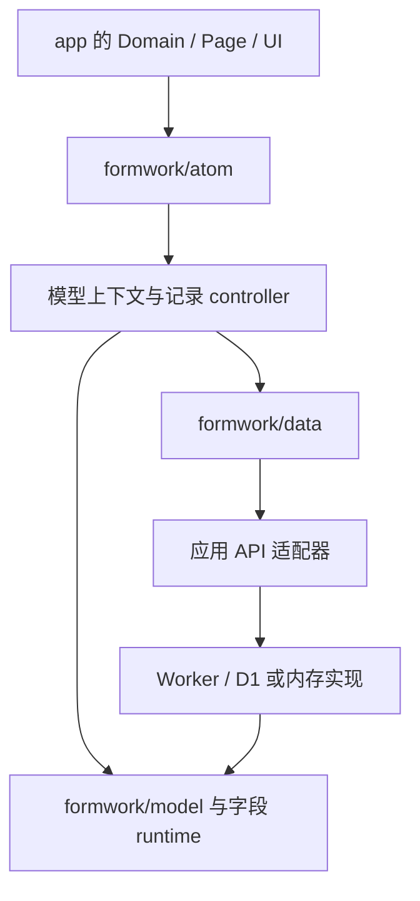

# Formwork 重构设计

当前实现使用 headless 数据协议、显式路由声明和可组合 atom。默认 list 已接入完整记录管理，tree-list 和 videos 是简单组合示例。应用拥有组件与样式；框架提供模型加工、查询、编辑和导航生命周期。

## 从一个应用入口开始

```text
src/
  formwork/
    api.ts
    components/index.tsx
    ui.ts
    index.ts
  domains/
    list/index.tsx
    tree/index.tsx
    videos/index.tsx
    index.ts
  pages/
    models/index.ts
    model-preview/index.ts
    index.ts
  main.tsx
```

```ts
// formwork/index.ts
import { defineFormwork } from "formwork";
import { apis } from "./api";
import { components } from "./components";
import { ui } from "./ui";
import { domains } from "../domains";
import { pages } from "../pages";

export default defineFormwork({ apis, components, ui, domains, pages });
```

```tsx
// main.tsx
import { render } from "solid-js/web";
import { Formwork } from "formwork";
import app from "./formwork";
import "./style.css";

render(() => <Formwork app={app} class="root-formwork" />, document.getElementById("root")!);
```

`domains` 和 `pages` 显式传入，缺省项用空数组。`Formwork` 为每次挂载创建独立运行环境，`class` 用作原生 CSS 的作用域。内存预览还可传入 `memoryHistory`。

最小完整项目位于 [examples/headless](../examples/headless/README.md)。它使用独立内存 API 和一套朴素 UI，不导入 CMS、Worker 或 Formwork Vite 插件。

## 默认 list 与自定义布局

```tsx
// domains/list/index.tsx
import { defineDomain } from "formwork";
import { Records, Detail, Editor } from "formwork/atom";

export default defineDomain({
  router: "list",
  render: () => (
    <Records
      presentation="modal"
      detail={(operation) => <Detail operation={operation} />}
      create={(operation) => <Editor operation={operation} />}
      edit={(operation) => <Editor operation={operation} />}
    />
  ),
});
```

```ts
// domains/index.ts
import list from "./list";
import tree from "./tree";
import videos from "./videos";

/** 汇总应用声明的模型布局。 */
export const domains = [list, tree, videos];
```

Domain 的 router 决定 `/list/:modelId`、`/tree-list/:modelId` 或 `/videos/:modelId`。`render` 得到已加工的 ModelContext，其子 atom 可以继承当前模型，不必反复传递 ctx。

`Records` 组合动作、筛选、表格、分页和记录出口。app.ui 将这些能力映射到 app.components 中的实际 UI。详情和编辑 slot 使用函数，在激活时才创建内容；省略 slot 使用框架默认行为，传 false 禁用相应操作。

特殊布局使用一个 `createRecordList()`，让 Filters、RecordActions、Pagination、RecordOutlet 共用它，中间用普通 JSX 渲染业务内容。每个 controller 只能挂一个 outlet；同一模型的多个集合使用不同 scopeKey。实际示例见 [tree](../apps/client/src/domains/tree/index.tsx) 与 [videos](../apps/client/src/domains/videos/index.tsx)。

tree-list 只按当前查询页的父节点分组，不承诺完整树查询；videos 只展示记录卡片和默认 Detail，不包含播放器、转码或媒体存储。

## 普通页面和模型分类

```tsx
import { definePage } from "formwork";
import { Detail } from "formwork/atom";

export default definePage({
  router: "featured",
  render: () => <Detail modelId="articles" recordId="a1" />,
});
```

Page 地址固定为 `/featured`。实际管理页为 `/models?modelId=articles`，预览为 `/model-preview?modelId=articles&router=list&revision=…`。PageContext 提供 data、query、navigate、confirm、guard 和取消信号，不会隐式请求模型。

`schema.domain` 保留如 `"cms"` 的业务分类。它不选择前端 Domain；前端根据 URL 的 router 选择布局。跨布局的 CMS 规则放在 app transform 中按分类判断，再由具体 Domain 补充覆盖。

## Schema 和 UI 定制

字段以 `schemaVersion:1` 保存真实 JSON 值契约。app.components 独立注册组件，app.ui 选择默认映射。format 契约只描述字段和值规则；当前 cmsContract 的 richtext 要求 string，app 使用 Text 多行输入，不解释为 HTML。

```ts
import type { SchemaTransform } from "formwork";

/** 在所有 CMS 布局中替换文章标题的表单组件。 */
export const transformSchema: SchemaTransform = (ctx) => {
  if (ctx.schema.domain === "cms" && ctx.modelId === "articles") {
    const title = ctx.schema.data.title;
    if (title && title.ui.form !== false) title.ui.form.component = "RichTitle";
  }
  return ctx;
};
```

`RichTitle` 必须先注册。框架克隆来源 Schema、解析 `$ref`、初始化场景配置，再按 app → Domain → 局部执行 transform。函数修改 ctx.schema 并返回同一个 ctx；来源副本被冻结。hook 可以异步执行，过期结果由取消信号排除。

字段场景覆盖、单次 RenderItem 覆盖和服务端校验的精确顺序见[运行时 API](formwork-api-architecture.md)。前端展示定制不改变后端权限；source Schema、业务记录和可编辑草稿各自保存。

## 保留有明确用途的 atom

| API                                                 | 必要性                                          |
| --------------------------------------------------- | ----------------------------------------------- |
| Records                                             | 标准列表一次装配，所有模型复用                  |
| Detail / Editor                                     | 同一详情或编辑能力可进入页面、弹窗和自定义布局  |
| RecordOutlet                                        | 将 URL/动作和延迟 slot、presenter、清理连接起来 |
| Filters / RecordsTable / Pagination / RecordActions | 换布局时保留同一查询与动作状态                  |
| Fields / Field                                      | 在自定义编辑器中复用字段描述和受控绑定          |
| createRecordList / createRecordEditor               | 应用能重排 UI，同时复用查询、提交与错误处理     |

关系选择器依赖应用的具体交互，当前保留 app 实现和 records.options 数据能力。对象与数组复用底层 scope、ArrayHandle 和递归 renderer；没有为了命名对称另加 ArrayItems。模型管理和预览只有当前应用消费，暂不抽成管理 atom。没有通用 command 总线或批量删除事务。

## 数据协议与一致性

`FormworkApis` 约定模型和记录操作，不固定网络传输方式。当前 CMS 通过 HTTP client 接入 Worker；独立示例通过内存适配器接入。`createDataClient` 不依赖 Solid 或 DOM，负责请求输入、响应检查和成功后的变更通知。

| 对象           | 固定内容                             |
| -------------- | ------------------------------------ |
| ModelSnapshot  | schema、schemaRevision、capabilities |
| RecordSnapshot | id、data、revision、schemaRevision   |
| QueryResult    | items、total                         |
| RecordPatch    | set 根字段值、unset 根字段 Pointer   |

接口输入统一 modelId/recordId，快照自身使用 id。创建要求 ifSchemaRevision；更新和删除同时要求 ifSchemaRevision 与 ifRecordRevision。管理草稿和发布另用 management revision。

编辑器固定开始编辑时的两个版本，提交失败保留输入。模型和记录版本不一致时只尝试重新读取一次，持续变化则报冲突。服务端在事务内执行条件检查；静默读取最新版本重试会覆盖其他人的更改，因此没有这类写入重试。

值语义保留缺失、null、空串、0 和 false 的区别。新建补默认值，编辑已存记录和筛选状态不补。数组项的 UI key 仅负责渲染稳定性，不作为服务端业务身份；受限数组替换不能绕过字段校验。

## 操作与预览生命周期

记录地址为 `/router/:modelId/create`、`/edit/:recordId`、`/detail/:recordId`。从列表点击时使用配置的 presenter；直达或刷新使用 page presenter，不依赖丢失的背景页面状态。

详情读取完整记录，编辑创建独立 scope。保存成功关闭操作并刷新相关列表；取消、切换、浏览器导航和卸载释放旧 owner、请求与守卫。未保存时先确认；删除也先确认。当前使用单个活动操作，不实现任意层数的窗口栈。

预览重新挂载 Formwork，使用相同 domains/components/ui 和独立内存 API。管理页 iframe 通过受校验的通信传入有效 Schema，可即时显示尚未保存的修改；外部预览链接固定审阅的 draft revision 或发布 version。预览记录不会写入正式数据库。

## 服务端与可选工具链

服务端继续使用 Cloudflare Worker、Hono 和 D1。模型、权限、关系和存储计划由纯 TypeScript 契约编译。初次启动建立 metadata、系统模型和管理员；普通 dev 保留数据，dev:reset 显式重置。

模型发布检查稳定字段身份、物理存储、关系目标和已有记录兼容性。此次按新项目重构，删除历史协议转换与数据库升级工具；未来的数据保护不因此取消。

Vite 插件只静态分析显式应用入口、生成能力清单与可选开发登记。应用运行不依赖插件，不需要 JSX 转换或目录扫描。CMS 的 capabilities:register 可直接分析入口并登记。

MCP 保留发现能力、读取/校验/保存模型草稿和生成预览。清单按 app、domains、pages 表达，查询目标统一 `{modelId,router}`；无法静态确定的行为报告 runtimeChecks。模型发布仍由管理页执行，没有能力清单也可发布。

## 依赖与实现验证



图 1：应用 UI 依赖框架的状态和协议，框架不反向导入应用视觉组件。

源码测试覆盖无插件接入、Schema 加工顺序、多个集合、独立 Editor、取消、直达及冲突；HTTP 测试覆盖模型发布、记录条件写入和清单并发；E2E 覆盖正式 list、模型预览和账号权限。结果与范围见[验收记录](formwork-redesign-review.md)。
