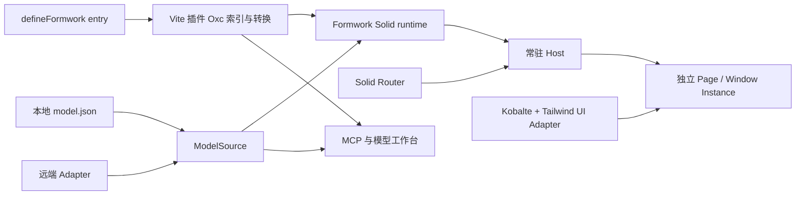
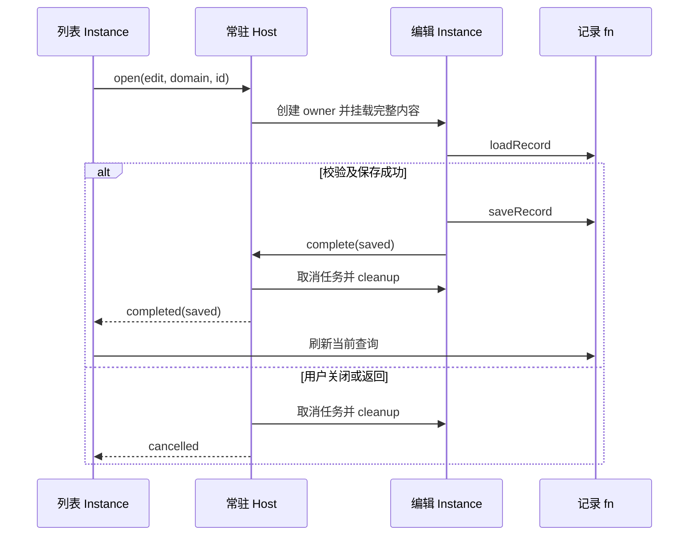

# Formwork 重构设计与迁移方案

重构采用 Solid、Tailwind CSS、Vite，围绕 `defineFormwork → definePage / defineWindow → 可选 defineDomain` 收敛。模型保存业务数据描述与可选视图，页面定义保存代码能力，每次挂载创建独立 Solid Instance。共享字段渲染、表达式与清理集中在 formwork，UI 由客户端提供。

技术取舍已确认：Kobalte 提供基础交互，Solid Router 管理 URL 与 History，数据请求使用 Solid primitives 和原生 fetch；TypeScript 7 负责类型检查，Oxc Parser 与 Magic-string 负责 Vite 插件的静态分析和转换。

阶段 0–7 已于 2026-10-29 实施：四个目标位置与公开导出可运行，默认入口已切换为 client/service，五项旧前端目录和生成链已清理。真实工具链、模型/Window/插件/MCP/HTTP/客户端验收已执行；启动步骤与证据见 [开发与验收说明](./formwork-development.md)。具体契约参见 [定义与运行机制细化设计](./formwork-design.md)，迁移前事实保留在 [源码分析](./formwork-source-analysis.md)。下文方案和示例保留为设计依据，实际文件组织以当前源码为准；生产平台与历史迁移仍是后续范围。

## 1 重构目标与已确认约束

减量目标是减少同一信息的表示数量、同一行为的装配入口和调用者必须理解的概念。稳定数组身份、异步结果失效、校验和资源清理对应真实业务行为，应由集中后的 Implementation 继续承担。

| 已确认约束       | 设计中的落点                                                       |
| ---------------- | ------------------------------------------------------------------ |
| Solid-only       | 直接使用 owner、signal、store、resource，去掉 React 订阅桥         |
| 无头内核         | UI 组件、样式、字段外壳与 Presenter 属于 apps/client               |
| 四个目标位置     | packages/formwork、packages/vite-plugin、apps/client、apps/service |
| define* 收敛     | defineRender 的能力并入 Page，不增加 form/filter/table 类型        |
| Zod 校验模型文档 | Page.schema 校验 getSchema 的返回值，区别于 Model.data             |
| 默认视图         | DataSchema 足以自动生成字段视图，views 是可选定制                  |
| 稀疏 Domain      | 只声明少数私域覆盖，普通模型不需要注册模块                         |
| 唯一模型身份     | Model.id 等于 URL domain、Domain key、ctx.domain 与 MCP modelId    |
| 可信表达式       | 保留 `{{ ... }}` JavaScript，支持响应式、函数与异步结果            |
| 固定 Window 形态 | presentation 在定义中固定，URL 直达与 open 使用同一内容            |
| 本地与远端源     | schema 就近定义，支持加载与上传，完整管理源独立于权限投影          |
| MCP 模型编辑     | 按 id 读写模型、查询能力、校验和定位预览；代码使用本地文件工具修改 |
| 全新协议         | 不要求新 schema/API 兼容历史前端协议                               |
| 首版后端范围     | 保留接入契约；完整发布、权限与物理存储迁移后续设计                 |

`Module` 拥有 Interface 与 Implementation；`Seam` 是替换实现的位置，`Adapter` 是满足 Interface 的具体实现。Depth 体现一次调用隐藏多少必要工作，Locality 体现改动集中在哪个位置。包变少只有在重复知识和装配也随之减少时才有价值。

## 2 当前表示与装配怎样收敛

当前工程已有全局默认与私域回退、默认 CRUD 模板、稳定数组项身份和异步清理。重构保留这些能力，替换为更直接的定义和运行路径。

| 现有位置                                                                                                  | 已核实的现状                                   | 重构处理                                                  |
| --------------------------------------------------------------------------------------------------------- | ---------------------------------------------- | --------------------------------------------------------- |
| [客户端依赖](file:///Users/bytedance/Documents/cowork/alien-form/apps/alien-mdm/package.json)             | React、Ant Design、react-router-dom、dnd-kit   | 客户端改为 Solid + Kobalte + Tailwind，旧适配不进入新内核 |
| [当前 Vite 配置](file:///Users/bytedance/Documents/cowork/alien-form/apps/alien-mdm/vite.config.ts)       | React 与 Tailwind 插件、API 开发代理           | 使用 Solid 插件与 formwork 插件，业务请求接入仍归应用     |
| [启动入口](file:///Users/bytedance/Documents/cowork/alien-form/apps/alien-mdm/src/app/bootstrap/main.tsx) | 应用启动与装配                                 | 对应新 apps/client 的入口与 defineFormwork 装配           |
| [样式入口](file:///Users/bytedance/Documents/cowork/alien-form/apps/alien-mdm/src/styles/global.css)      | 全局样式                                       | 新客户端建立 Tailwind CSS 样式、token 与 UI Adapter       |
| packages/core                                                                                             | 字段、数组、表达式、异步失效与 cleanup         | 用 Solid 原生机制实现相同行为                             |
| packages/engine                                                                                           | 模型编译、registry、PageRuntime、渲染装配      | 合并共享计算，不保留重复描述与四套注册空间                |
| packages/protocol                                                                                         | 数据、存储、关系、表单与页面混合在 AlienSchema | 改为 Model/Data/View；存储与代码定义拥有独立职责          |
| packages/react                                                                                            | 状态订阅及字段渲染桥                           | 等新 Interface 行为验收完成后删除                         |
| packages/sdk                                                                                              | 请求接入                                       | 由应用 fn 与原生 fetch 接入                               |
| packages/alienbase、apps/alien-worker                                                                     | 模型发布、权限和记录逻辑，Workers/Hono/D1 部署 | 保留现状作为后端事实与对照，首版先定义接入契约            |

当前模型编辑与预览包含 ModelDraft、AlienSchema、展开表单 schema、编译节点等多次转换。新的工作台直接读取完整 ModelDocument，进入实际页面的同一挂载流程；传统编辑器草稿不再成为模型的另一份权威描述。

当前 modal/drawer 路径会从目标页面提取局部表单。新的 Window 挂载完整目标定义，布局、动作、私域组件与字段容器都保留。保存完成与列表刷新通过一次完成结果相连。

## 3 稳定版本与技术选择

以下版本来自核对日的 npm `latest` 与 Node 官方发行索引，是稳定版本快照。每项版本链接指向实际查询的官方发布元数据。实施时通过 workspace 与 lockfile 固定这组版本，不让运行环境随 latest 漂移。

| 用途            | 基线                                                                                                               | 选择理由与归属                               |
| --------------- | ------------------------------------------------------------------------------------------------------------------ | -------------------------------------------- |
| UI 与响应式     | Solid [1.9.17](https://registry.npmjs.org/solid-js/latest)                                                         | 原生状态与生命周期，formwork 的响应式基础    |
| 样式            | Tailwind CSS [4.3.3](https://registry.npmjs.org/tailwindcss/latest)                                                | 统一应用样式与 token，限客户端               |
| 样式构建        | @tailwindcss/vite [4.3.3](https://registry.npmjs.org/@tailwindcss/vite/latest)                                     | 官方集成，peer 范围包含 Vite 8               |
| 开发与构建      | Vite [8.3.5](https://registry.npmjs.org/vite/latest)                                                               | 客户端、library mode 与自定义插件平台        |
| Solid 编译      | vite-plugin-solid [2.11.14](https://registry.npmjs.org/vite-plugin-solid/latest)                                   | peer 范围支持所选 Solid 与 Vite              |
| 基础交互        | @kobalte/core [0.13.14](https://registry.npmjs.org/@kobalte/core/latest)                                           | 已确认，无头控件、焦点与键盘交互             |
| 路由            | @solidjs/router [1.0.0](https://registry.npmjs.org/@solidjs/router/latest)                                         | 已确认，URL、匹配、导航与 History            |
| 请求与页面状态  | 原生 fetch、Solid primitives                                                                                       | 已确认，scope/页面状态与请求流程保持明确     |
| 类型检查        | TypeScript [7.0.2](https://registry.npmjs.org/typescript/latest)                                                   | 已确认，最新稳定主版本                       |
| 插件 TSX 分析   | oxc-parser [0.156.0](https://registry.npmjs.org/oxc-parser/latest)                                                 | 已确认，静态分析与类型检查解耦               |
| 插件源码转换    | magic-string [1.4.5](https://registry.npmjs.org/magic-string/latest)                                               | 已确认，局部转换与 sourcemap                 |
| 模型校验        | Zod [4.6.7](https://registry.npmjs.org/zod/latest)                                                                 | 延续文档契约，在浏览器与 Node 复用 validator |
| workspace       | pnpm [12.16.1](https://registry.npmjs.org/pnpm/latest)                                                             | 延续现有包管理方式，统一版本                 |
| Node 工具链     | Node.js [26.13.0 LTS](https://nodejs.org/dist/index.json)                                                          | 核对日最新 LTS，满足所选工具 engines         |
| Module 行为测试 | Vitest [5.0.5](https://registry.npmjs.org/vitest/latest)                                                           | 测试 scope、源、表达式和插件可观察行为       |
| 实际 UI 验证    | @playwright/test [1.64.1](https://registry.npmjs.org/@playwright/test/latest)                                      | 在真实浏览器验证 Solid UI 与导航             |
| 检查与格式      | Oxlint [1.90.0](https://registry.npmjs.org/oxlint/latest)、Oxfmt [0.75.0](https://registry.npmjs.org/oxfmt/latest) | 延续现有工具种类                             |
| MCP 协议        | @modelcontextprotocol/sdk [1.32.2](https://registry.npmjs.org/@modelcontextprotocol/sdk/latest)                    | 官方 SDK 承载 stdio，peer 范围支持 Zod 4     |

[Kobalte](https://kobalte.dev/docs/core/overview/introduction)提供无样式的基础组件以及焦点、键盘与 ARIA 交互。应用 Adapter 将其转为 FieldProps 和 PresenterProps；Tailwind CSS 决定外观。Kobalte 不进入模型格式或字段状态实现。

[Solid Router](https://docs.solidjs.com/solid-router)管理地址与导航，Formwork 管理独立内容实例和 Window 结果。首版不引入 TanStack Query/Table：请求使用 createResource/fetch，表格的列、排序、选择和分页在应用 Table Adapter 内维护。

TypeScript [7.0.2 的发布入口](https://registry.npmjs.org/typescript/7.0.2)不提供旧版 Compiler API，新的 AST API 位于 unstable subpath。插件因此使用 Oxc 解析 TSX、使用 Magic-string 转换，TypeScript 只负责类型检查与声明产物；不把不稳定编译器 API 变成插件依赖。

这组 peer 与 engines 的声明相容，尚未做实际安装和构建验证。首个代码阶段需使用真实 Solid、TS7、Zod 4 与 Vite 8 验证，而不能用上一轮类型桩检查替代。

基础栈不加入 SolidStart/SSR、额外状态库、通用表单库、完整表格库、请求缓存库或传统拖拽模型编辑器。图标、富文本等能力按私域需求接入；生产后端平台仍在后续范围。

## 4 目标包结构与依赖方向

以下目录是目标结构，当前仓库尚未创建这些新包和应用。

```text
packages/
  formwork/
    src/
      model/       Model/Data/View、Zod、源契约与无 UI 校验
      runtime/     define*、Instance、scope、表达式与 cleanup
      render/      默认视图、字段绑定与共享 Render
      router/      Solid Router 集成与常驻 Window host
      mcp/         六项模型工具与官方 SDK 接入
  vite-plugin/
    src/           Oxc 索引、源码转换、文件源、HMR 与 dev 承载
apps/
  client/
    src/
      ui/          Kobalte/Tailwind、字段容器、Table、Presenter
      pages/       Home、List、记录 Window 与模型工作台
      models/      无私域代码的 model.json
      domains/     稀疏私域代码、model.json 与就近 validator
      fn/          请求、查询转换、工具与行为
  service/         后续完整远端模型源与记录接入
```

| Module     | 对外 Interface                  | Implementation 集中的工作              |
| ---------- | ------------------------------- | -------------------------------------- |
| 定义与挂载 | define*、app.render、ctx.open   | 覆盖、模型加载、owner、终态与销毁      |
| 字段与视图 | ctx.createScope、ctx.Render     | 默认视图、绑定、校验、数组身份与表达式 |
| 模型源     | list/read/write                 | 完整源、revision 与文件/HTTP 传输      |
| Vite 插件  | formworkPlugin、virtual 模块    | 静态定义、转换、诊断、本地文件与 HMR   |
| 模型工具   | MCP 六项操作                    | 能力汇总、校验、条件写入与预览定位     |
| 应用 UI    | FieldProps、字段容器、Presenter | 控件值转换、布局、表格状态和交互呈现   |

包导出使用 `formwork`、`formwork/model`、`formwork/mcp` 和 `formwork-vite-plugin`。Node 加载 model/mcp subpath；它们的依赖图不包含 Solid JSX、DOM 或应用 UI。Kobalte/Tailwind 限客户端，Oxc/Magic-string 限插件，MCP SDK 限工具入口的运行图。

图 1　静态定义与模型源汇合为独立内容实例



插件处理静态模块与本地文件，Source 提供动态目录与完整模型，runtime 创建内容状态。Router 的匹配结果输入常驻 Host，Host 持有各 Instance；UI Adapter 负责呈现。修改模型和实际预览都使用同一 Source。

## 5 定义与模型使用同一身份

### 5.1 四个定义的职责

| 定义           | 保存的信息                                                           | 生命周期                          |
| -------------- | -------------------------------------------------------------------- | --------------------------------- |
| defineFormwork | models、共同组件、字段容器、fn、页面与 Presenter                     | 静态应用描述                      |
| definePage     | router/path、schema/getSchema、container 或普通 render、可选 domains | 每次挂载创建 Instance             |
| defineWindow   | Page 内容与固定 presentation、returnTo                               | 每次 open 或直达创建独立 Instance |
| defineDomain   | 指定模型的稀疏组件、fn、来源与 validator 覆盖                        | 自身不创建 Instance               |

`router` 是清单中唯一的定义名，`path` 是 URL 模式。普通页面默认 `"/" + router`；schema 页显式包含 `:domain`。模型 id 与 router 使用单段小写标识，模型 id 规则为 `^[a-z][a-z0-9_-]*$`。记录 id 独立，作为路径参数按段编码。

| router | path                | 实际访问                |
| ------ | ------------------- | ----------------------- |
| home   | 默认 /home          | /home                   |
| models | /models/:domain?    | /models、/models/orders |
| list   | /list/:domain       | /list/orders、/list/cms |
| add    | /add/:domain        | /add/orders             |
| edit   | /edit/:domain/:id   | /edit/orders/record-1   |
| detail | /detail/:domain/:id | /detail/orders/record-1 |

URL domain 必须等于最终文档 id。title 只用于展示，type 用于数据节点的值类型；不另存 name/domain 作为模型寻址键。新增 orders 无须改 Page 清单，也无须创建 orders Domain。

### 5.2 DataSchema 与 ViewSchema

ModelDocument 保存 `{ id, title, data, views? }`。`data` 描述业务值，`views` 描述可选组件树，页面代码与存储 DDL 不进入文档。字段通过 properties 定义、通过 required 声明必填，不重复存储另一份 fields/form。

首版 DataSchema 支持标量、object、array、properties/required/items、title/description/default/readOnly、enum、字符串/数值/数组约束、可空标量、根 `$defs` 与本地 `$ref`。不支持的关键字产生诊断；外部引用、任意组合 schema 和存储关系协议留在后续范围。

```json
{
  "id": "orders",
  "title": "订单",
  "data": {
    "type": "object",
    "properties": {
      "id": { "type": "string", "title": "记录 ID", "readOnly": true },
      "orderNo": { "type": "string", "title": "订单号", "minLength": 1 },
      "status": {
        "type": "string",
        "title": "状态",
        "enum": ["pending", "paid"],
        "default": "pending"
      },
      "paid": { "type": "boolean", "title": "已付款", "default": false },
      "amount": { "type": "number", "title": "金额", "minimum": 0 },
      "lines": {
        "type": "array",
        "title": "明细",
        "items": {
          "type": "object",
          "properties": {
            "sku": { "type": "string", "title": "SKU" },
            "quantity": { "type": "integer", "title": "数量", "minimum": 1 }
          },
          "required": ["sku", "quantity"]
        }
      }
    },
    "required": ["orderNo", "status"]
  }
}
```

没有 View 时默认按字段枚举顺序生成组件：enum→Select，string→Input，number/integer→NumberInput，boolean→Switch，object→Object，array→Array，null→Null。容器与字段容器决定摆放方式，scope 决定值是否可编辑。

View 使用 `component/field/props/children/bindings`。field 是相对当前值根的 JSON Pointer，空字符串表示根。命名视图整体替换，不按数组下标深合并；对象节点未声明 children 时继续生成默认子字段。

```json
{
  "id": "cms",
  "title": "内容",
  "data": {
    "type": "object",
    "properties": {
      "id": { "type": "string", "readOnly": true },
      "title": { "type": "string", "title": "标题", "minLength": 1 },
      "content": { "type": "string", "title": "正文" }
    },
    "required": ["title"]
  },
  "views": {
    "edit": {
      "component": "Object",
      "field": "",
      "children": [
        { "component": "Input", "field": "/title" },
        { "component": "RichText", "field": "/content" }
      ]
    }
  }
}
```

`Page.schema` 是 Zod validator，校验上述完整文档；`Model.data` 校验表单值。有效 validator 可以做 refinement 或归一化，但运行时归一化不自动写回完整源。

### 5.3 一套应用定义访问多个模型

以下代码展示目标 Interface，用到的 UI、页面与 fn 是拟议应用文件；不表示当前仓库已有这些导出。

```tsx
// apps/client/src/formwork.tsx
import { defineFormwork, definePage, defineWindow } from "formwork";
import { modelDocumentSchema } from "formwork/model";
import models from "virtual:formwork/models";
import {
  Input,
  NumberInput,
  Select,
  Switch,
  ObjectFields,
  ArrayFields,
  NullValue,
  FormShell,
  FormItem,
  PagePresenter,
  ModalPresenter,
  DrawerPresenter,
  Home,
} from "./ui";
import { List } from "./pages/list-content";
import { RecordEditor, RecordDetail } from "./pages/record-content";
import { ModelWorkbench } from "./pages/model-workbench";
import * as recordFns from "./fn/records";

const domains = { cms: () => import("./domains/cms") };

const home = definePage({ router: "home", render: () => <Home /> });
const modelsPage = definePage({
  router: "models",
  path: "/models/:domain?",
  render: ModelWorkbench,
});
const list = definePage({
  router: "list",
  path: "/list/:domain",
  schema: modelDocumentSchema,
  getSchema: async (ctx) => (await ctx.models.read(ctx.domain, { signal: ctx.signal })).document,
  container: List,
  domains,
});
const add = defineWindow({
  router: "add",
  path: "/add/:domain",
  presentation: "modal",
  returnTo: "list",
  container: RecordEditor,
  domains,
});
const edit = defineWindow({
  router: "edit",
  path: "/edit/:domain/:id",
  presentation: "drawer",
  returnTo: "list",
  container: RecordEditor,
  domains,
});
const detail = defineWindow({
  router: "detail",
  path: "/detail/:domain/:id",
  presentation: "drawer",
  returnTo: "list",
  container: RecordDetail,
  domains,
});

/** 组合普通页面、动态模型页面与固定 Window 定义。 */
export default defineFormwork({
  models,
  components: {
    Input,
    NumberInput,
    Select,
    Switch,
    Object: ObjectFields,
    Array: ArrayFields,
    Null: NullValue,
  },
  container: FormShell,
  fieldContainer: FormItem,
  fn: recordFns,
  pages: [home, modelsPage, list],
  windows: [add, edit, detail],
  presenters: {
    page: PagePresenter,
    modal: ModalPresenter,
    drawer: DrawerPresenter,
  },
});
```

schema 和 getSchema 可以从 Formwork 默认值继承；未声明 getSchema 时调用 models.read。上例在 list 中显式写出加载过程，Window 直接使用共同默认值。普通 render 不触发模型加载。

```tsx
// apps/client/src/domains/cms/index.tsx
import { defineDomain } from "formwork";
import { RichText, CmsTitle } from "./components";
import { loadCmsRecords } from "./fn";
import { cmsDocumentSchema } from "./model.schema";

/** 为 cms 补充组件、请求与文档校验，不注册其他模型。 */
export default defineDomain({
  schema: cmsDocumentSchema,
  components: { Input: CmsTitle, RichText },
  fn: { loadRecords: loadCmsRecords },
});
```

cms 的 model.json、model.schema.ts、私域代码就近放置。只有访问 cms 时加载该模块。远端来源也可通过 Domain.getSchema 显式选择；模型目录仍由 Formwork.models 提供，不从 domains 推断。

## 6 共用渲染与实例生命周期

### 6.1 两个入口接入不同容器

`ctx.createScope` 创建独立值根，`ctx.Render` 渲染这组值。普通表单可以直接使用 Page 默认 children；Filter 创建 partial 草稿，Table 为每条记录创建只读 scope。它们共享 DataSchema、字段绑定与表达式解释。

```tsx
// apps/client/src/pages/list-content.tsx
import { createResource, createSignal } from "solid-js";
import type { Component } from "solid-js";
import type { JsonValue, PageContext } from "formwork";
import {
  ListShell,
  FilterShell,
  FilterItem,
  BooleanFilter,
  TableShell,
  TableRow,
  TableCell,
  ReadText,
  ReadBoolean,
  ReadObject,
  ReadArray,
} from "../ui";
import { makeQuerySchema } from "../fn/query-schema";

type RecordValue = { id: string; [key: string]: JsonValue };

/** 让筛选草稿与表格行使用同一个字段渲染入口。 */
export const List: Component<PageContext> = (ctx) => {
  const Render = ctx.Render;
  const draft = ctx.createScope({
    schema: makeQuerySchema(ctx.model.data),
    defaults: false,
  });
  const [query, setQuery] = createSignal<JsonValue>({});
  const [rows, { refetch }] = createResource(
    query,
    async (value) => (await ctx.fn.loadRecords(value)) as RecordValue[],
  );
  return (
    <ListShell>
      <Render
        scope={draft}
        view={ctx.model.views?.["list.filter"]}
        container={FilterShell}
        fieldContainer={FilterItem}
        components={{ Switch: BooleanFilter }}
      />
      <button
        onClick={async () => {
          if ((await draft.validate()).status === "valid") setQuery(draft.value() ?? {});
        }}
      >
        查询
      </button>
      <TableShell
        rows={rows() ?? []}
        rowKey="id"
        columns={Object.keys(ctx.model.data.properties)}
        row={(record: RecordValue) => {
          const row = ctx.createScope({
            value: record,
            defaults: false,
            readOnly: true,
          });
          return (
            <TableRow>
              <Render
                scope={row}
                view={ctx.model.views?.["list.row"]}
                container={(props) => props.children}
                fieldContainer={TableCell}
                components={{
                  Input: ReadText,
                  NumberInput: ReadText,
                  Select: ReadText,
                  Switch: ReadBoolean,
                  Object: ReadObject,
                  Array: ReadArray,
                }}
              />
              <td>
                <button
                  onClick={async () => {
                    const result = await ctx.open("edit", {
                      domain: ctx.domain,
                      id: record.id,
                    });
                    if (result.status === "completed") await refetch();
                  }}
                >
                  编辑
                </button>
              </td>
            </TableRow>
          );
        }}
      />
    </ListShell>
  );
};
```

makeQuerySchema 是应用查询策略：选可查询的标量，去掉 required/default/readOnly，保留适用值约束。草稿变化不改变已应用查询；提交生成普通 JSON 快照。loadRecords 将它转换成业务请求，查询协议不进入持久化 Model。

TableShell 在稳定记录 id 的 owner 下调用 row，维护列、分页、排序和选择。缺失/重复记录 id 报数据错误；服务端同 id 新数据必须更新行 scope 或重挂载该行，不能保留旧对象闭包。复杂字段用摘要组件，避免默认字段容器生成嵌套 td。

`list.filter`、`list.row` 是应用选用的普通 view key，未声明时自动生成该 scope 的字段。Page.container 不传给内层 Render；components 与 fieldContainer 继续继承。局部 `Switch: BooleanFilter` 必须保留 true/false/undefined，不转成字符串。

FieldProps 为值组件提供响应式 value/onChange/readOnly/disabled/errors/schema；数组另外提供稳定项的 ArrayHandle 与惰性 Item。readonly 由 scope 或 data 增加，控件样式与值转换由 Adapter 处理；props 不得覆盖受控绑定。

### 6.2 静态描述与可变状态分开

| 信息                 | 寿命与约束                                             |
| -------------------- | ------------------------------------------------------ |
| define* 描述         | 不在定义时执行请求、构造 JSX 实例或创建表单状态        |
| 编译描述             | 同一来源与文档版本可以复用，缓存不包含字段值或数组 key |
| Page/Window Instance | 每次独立 owner、请求取消、scope 与终态                 |
| 默认 scope           | 首次访问时创建，使用 model.data；创建新值时补 default  |
| 显式 scope           | 本次 owner 下创建，卸载自动清理                        |
| scope.value          | 返回独立普通 JSON 快照，适合请求序列化                 |
| reset(value)         | 装载给定值、不补 default，重建数组身份并淘汰旧任务     |
| array move/remove    | move 保留身份；remove 清理项 owner、校验与异步结果     |

一次挂载先建立加载用 owner 与 signal，解析 Domain，取得模型并校验最小结构、有效 Zod 和 id，再创建需要的值状态与内容。已声明 Domain 加载失败时阻止内容挂载；未声明 Domain 正常使用默认能力。

### 6.3 可信表达式使用一份上下文

| 名称    | 含义                                                |
| ------- | --------------------------------------------------- |
| $ctx    | 当前 domain、params、signal 与 navigate/open 等行为 |
| $model  | 本次校验后的模型描述                                |
| $values | 当前 Render 值根，以字段访问跟踪依赖                |
| $value  | 当前字段值，布局节点中不存在                        |
| $field  | 当前相对路径及 schema                               |
| fn      | 已按当前上下文绑定首参的有效函数                    |

同一个 `$values.id` 在 Table 中读取当前记录，不额外拼 `$row/$form/$service`。fn 实现首参为 ActionContext；表达式和 ctx.fn 调用只传业务参数。动态 registry 的签名有类型擦除，工具返回可确定的声明与 JSDoc，应用可补充自己的绑定函数类型。

完整匹配 `{{ ... }}` 的 props 字符串作为 JavaScript 表达式执行；返回函数交给事件，返回 Promise 按本次属性的最新轮次落地。普通字符串保持原样，首版不处理混合字符串插值。

```json
{
  "component": "NumberInput",
  "field": "/amount",
  "bindings": {
    "value": "{{ fn.quote($values.lines) }}",
    "readOnly": true
  }
}
```

bindings 明确声明字段值写入、只读、禁用和可见状态。value writer 每个 scope/path 只能有一个，实际字段读取形成的依赖图不得有环。旧 Promise、旧校验或销毁后的结果不写回；隐藏视图不删除业务值或削弱 DataSchema 的约束。

### 6.4 Window 挂载完整目标内容

Solid Router 的匹配结果进入常驻 Host。Host 保留打开 Window 的调用者 owner，Window 捕获独立 params/model 快照，不订阅随后变化的全局 route params。普通 navigate 销毁旧根及附属窗口；open 暂时保留调用者。

| 情况             | 固定行为                                                   |
| ---------------- | ---------------------------------------------------------- |
| presentation     | page/modal/drawer 来自定义，调用者不能覆盖                 |
| 内容             | 与目标 URL 的完整内容相同，不提取局部 form                 |
| 同一目标双开     | 两个独立 Instance                                          |
| page Window      | 隐藏调用者内容并保留 owner，结束后恢复                     |
| modal/drawer     | 调用者作为背景；直达时使用空的应用底层画布                 |
| complete         | 第一次 completed(value) 终态胜出，调用者据此刷新           |
| close/浏览器返回 | cancelled，结果只结算一次                                  |
| returnTo         | 直达结束后定位 definePage，所需参数取当前 Window.params    |
| 销毁             | 先禁止写入并取消，再执行全部 cleanup；单项失败不中断其余项 |

图 2　编辑结束后通过完成结果刷新原列表



编辑页负责装载、校验与提交；Host 负责承载与终态。加载失败展示错误并允许关闭/重试，不伪造 completed。returnTo:list 将 `/detail/orders/record-1` 的直达关闭定位为 `/list/orders`。

## 7 完整模型源与 Vite MCP 工作流

### 7.1 模型源的三个操作

| 操作                     | 契约                                                              |
| ------------------------ | ----------------------------------------------------------------- |
| list                     | 返回模型 id/title/revision/location/writable 的目录，以实际源为准 |
| read(modelId)            | 返回同一 revision 下的完整 document 与 completeness:full          |
| write(document, options) | 完整替换，创建用 ifRevision:null，更新用最近 read 的 revision     |

revision 是不透明字符串，location 是来源，二者不写入 ModelDocument。local.path 相对项目根，remote.uri 指向管理源。身份不匹配、模型无效、只读源或 revision 冲突都返回明确错误；更新失败不覆盖已有源。

本地开发源位于 Vite dev server，浏览器与 MCP 通过同一受控接入读写。文件写入串行检查 revision、写临时文件并原子替换；外部编辑器不受该锁控制，需比较内容版本并报告竞争，不能把 rename 当作完整外部并发保证。

本地生产 JSON 源只读；远端 ModelSource Adapter 负责认证、完整管理源与服务端原子条件写入。schema 就近不妨碍远端加载；上传是读取本地完整文档、取得远端 revision 后显式 write，不自动切换当前来源或修改数据库表。

旧权限投影不满足完整源契约。网络在提交后中断时先 read 核对结果，再决定下一次写入；取消 signal 不能撤销已提交的写入。

### 7.2 静态处理与运行时分别负责

```ts
// apps/client/vite.config.ts
import { defineConfig } from "vite";
import solid from "vite-plugin-solid";
import tailwindcss from "@tailwindcss/vite";
import { formworkPlugin } from "formwork-vite-plugin";

/** 在 Solid JSX 编译前完成定义索引与作者语法转换。 */
export default defineConfig({
  plugins: [
    formworkPlugin({
      entry: "src/formwork.tsx",
      models: ["src/models/**/model.json", "src/domains/**/model.json"],
    }),
    solid(),
    tailwindcss(),
  ],
});
```

| Vite 插件                                           | Formwork 运行时                         |
| --------------------------------------------------- | --------------------------------------- |
| 跟踪实际 entry 的 pages/windows/domains 引用        | 按当前路由读取动态模型与可选 Domain     |
| 检查静态 key、重复定义、路径歧义与局部文件          | 校验远端返回、有效 Zod、id 和组件能力   |
| Oxc 解析 TSX，Magic-string 生成局部变换及 sourcemap | 在当前 owner 下执行 render 工厂与表达式 |
| 将直接 `render: <Home />` 改为延迟工厂              | 为每次挂载创建新内容，不共享 JSX 实例   |
| 生成能力元信息、本地 JSON 源与 HMR 通知             | 维护 scope、请求轮次、校验与 cleanup    |

插件不把目录中的所有 definePage 都注册，也不执行 getSchema/fn/UI；只有明确的动态 import 承诺分块延迟加载。不用插件时普通页面使用 `render: () => <Home />`。

自定义 Zod schema 从就近 Node-safe `*.schema.ts` 导出。静态能力包含组件/fn key、覆盖来源、源码位置、显式 TS 声明与 JSDoc；不能准确导出 props schema 时返回原声明。模型校验入口不依赖 TS7 unstable API 或完整 UI 模块执行。

### 7.3 六项 MCP 操作

MCP 使用官方 SDK 的 stdio 入口，连接项目 dev server 的同一模型源和定义元信息。dev server 不可用时报告不可用，不启动另一套独立写入源。

| 工具                  | 输入                             | 输出                                   |
| --------------------- | -------------------------------- | -------------------------------------- |
| models.list           | 无必填参数                       | 完整源目录                             |
| models.read           | modelId                          | document、revision 与完整性元信息      |
| formwork.capabilities | modelId、router                  | 模型契约、有效组件/fn、覆盖与源码声明  |
| models.validate       | modelId、document、可选 router   | errors 与 runtimeChecks                |
| models.write          | modelId、document、ifRevision    | 校验后条件写入，返回新快照             |
| models.preview        | modelId、router、必要路径 params | modelId、router、revision 与工作台 URL |

errors 表示可确定的结构、字段引用、组件或语法错误，存在 errors 时拒绝 write。runtimeChecks 表示网络或表达式返回值等尚需运行验证的行为。额外命名 View 按实际 Render 的 scope/局部映射验证，不能把一次静态校验称为完整运行验收。

工具只接收 modelId，文件定位来自项目索引；TypeScript/Solid 代码仍由本地 agent 文件工具编辑。preview 不伪造记录 id，edit/detail 缺少参数时返回 PARAMS_REQUIRED。目录、来源、URL 与私域 key 一致。

模型工作台读取 list/read，使用实际页面路径建立新的预览 Instance，例如 `/models/orders?router=list&revision=...` 定位 `/list/orders` 的预览。写入或 HMR 后重读并重挂载，普通编辑页则保持当前快照，不自动合并新 schema 与未保存值。

## 8 迁移阶段按行为交付

| 阶段            | 拟改动的位置                                                         | 交付与通过条件                                                                  |
| --------------- | -------------------------------------------------------------------- | ------------------------------------------------------------------------------- |
| 0 真实工具链    | 根 workspace、两个新包与 apps/client；apps/service 契约位置          | 统一版本；真实 Solid/TS7/Zod/Vite 可安装、检查、构建；Node model 入口不触发 DOM |
| 1 模型与本地源  | formwork/src/model、vite-plugin 文件源、models/orders 与 domains/cms | 新文档可校验、读取和条件写入，重复 id/权限投影/冲突可诊断                       |
| 2 字段与渲染    | formwork/src/runtime 与 render、client/ui 字段 Adapter               | 默认视图可用，字段与数组身份稳定，过期结果不覆盖新状态                          |
| 3 定义与 Window | formwork/src/router、client Presenter 与页面定义                     | orders 默认加载，cms 稀疏覆盖，双开独立，URL 直达保持形态                       |
| 4 原生应用页面  | client/pages、ui/Table 与 fn                                         | Filter 草稿提交刷新，取消不刷新，完成刷新；普通 Home 与模型工作台可用           |
| 5 插件与 MCP    | vite-plugin、formwork/src/mcp、工作台预览                            | 静态定义错误可定位，转换保留 sourcemap，新 revision 进入真实预览                |
| 6 远端接入      | 后续 service 契约实现、远端 ModelSource、记录 fn                     | 同一 Interface 可替换本地源，完整远端文档与条件写入得到验证                     |
| 7 删除旧装配    | 被替代的 protocol/react/sdk 与 core/engine 装配、旧 builder/Overlay  | 新应用独立运行、验收通过后删除；不按名称批量删包                                |

旧应用与旧数据源保留为回退对照，直到新路径验收及切换完成。新 schema 不通过旧 GET 的投影写回，也不与旧物理存储共用隐式迁移写入路径。

首版业务记录 fn 可以接入明确的开发数据或已存在的业务服务，来源与验证状态须说明。ModelSource 可用不代表完整记录后端、权限或发布机制已经完成。

## 9 验收与后续范围

Vitest 跨公开 Interface 观察值、错误、revision 与资源释放；Playwright 观察真实 DOM、路由、焦点与 Window。已有行为用例迁移到新 Interface 后再替换旧测试，不围绕内部 AST/store 布局重复增加测试。

| 验收行为    | 可观察结果                                                   |
| ----------- | ------------------------------------------------------------ |
| 无私域模型  | /list/orders 不需要 orders Domain 即可加载                   |
| 覆盖次序    | Formwork → Page → cms → Render 同名项正确替换，未声明项保留  |
| 模型身份    | URL domain 与 document.id 不匹配时阻止挂载                   |
| 筛选值      | true/false/undefined 保值；草稿未提交不改变已应用查询        |
| 表格行      | 稳定记录 id 对应正确值；新查询重置页码与刷新状态             |
| 数组移动    | 值、错误、owner 与异步结果归原项，不串到原索引的新项         |
| 异步竞争    | 旧请求、旧校验、旧 expression 以及关闭后结果不能覆盖当前状态 |
| Window 双开 | 同模型两个窗口的值、请求、错误和终态独立                     |
| 完整内容    | 自定义布局、动作、私域组件与字段容器在 open/直达均生效       |
| 键盘与焦点  | Kobalte Dialog/Drawer 关闭、焦点恢复与返回行为符合 Host 终态 |
| 条件写入    | revision 冲突或校验失败保持已有完整源                        |
| 预览更新    | 新 revision 使用实际挂载流程，未复用旧表单或草稿             |
| cleanup     | 单项清理抛错不阻止其余清理执行                               |
| Node 入口   | model/mcp 导入不执行 UI、不要求 DOM                          |

构建验收包括真实依赖、TS7 类型与声明、Vite library mode、Solid 编译、插件 JSX 转换、生产只读源和浏览器测试。当前文档示例与先前类型桩检查不能代替这些结果。

生产后端平台、认证与权限、草稿/publish、物理数据库结构、关系查询及已有数据迁移后续单独设计。当前 Workers/Hono/D1 是现有事实，不构成本轮重新锁定的生产平台。图标、富文本及额外性能能力按具体私域需求评估，不提前扩展基础依赖。
