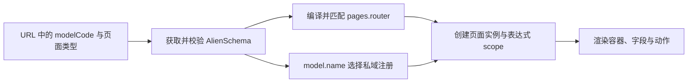
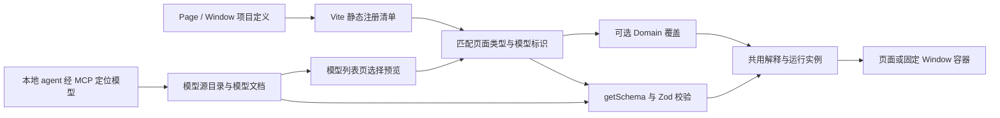

# Formwork 重构的源码分析

迁移前结论：框架可以围绕 `defineFormwork → definePage / defineWindow → 可选 defineDomain` 收敛。Page 定义可复用的页面行为，模型提供动态数据与视图，Domain 只补充少数模型的私域能力；共用渲染内核可以成为 Page 的内部实现，无须先要求使用者声明 `defineRender`。该方向已于 2026-10-29 按 [细化设计](./formwork-design.md) 完成阶段 0–7；当前运行与验收证据见 [开发说明](./formwork-development.md)。[Data-backed / Expert judgment]

下文保留迁移前的只读源码调查，历史链接中的 `apps/alien-mdm`、`packages/core/engine/react/sdk` 已按批准方案删除，可在 Git 历史中查阅。调查当时没有运行测试或请求线上数据库，“已接线”只表示当时存在调用链。当前实现与实际测试结果请使用开发说明，不把下文的旧接口当作现行 Formwork API。

## 用户已经明确的方向

| 约束           | 当前理解                                                                                   |
| -------------- | ------------------------------------------------------------------------------------------ |
| 包结构         | `packages/formwork`、`packages/vite-plugin`、`apps/client`、`apps/service`                 |
| 响应式         | 内核直接使用 Solid，只支持 Solid；UI 实现由应用提供                                        |
| 重构方式       | 从头设计 schema 与 API，不以历史前端接口或旧协议兼容性约束新设计                           |
| 页面           | schema 页面与普通 Solid 页面共用 `definePage`                                              |
| schema 校验    | `definePage.schema` 是 Zod 契约，校验 `getSchema` 返回值                                   |
| 路由           | 页面类型在前，动态模型标识在后，例如 `/list/{domain}`                                      |
| domain         | 大部分模型使用默认能力，只有少数需要显式声明私域覆盖                                       |
| 渲染           | Form、Filter、Table 共用渲染能力，容器、字段容器与组件映射决定呈现方式                     |
| 表达式         | 保留可信配置中的 `{{ ... }}`                                                               |
| 打开方式       | 在框架定义中固定；URL 直达也采用该展示方式                                                 |
| schema 来源    | 遵循就近原则，支持本地定义、远端加载及上传服务端                                           |
| 模型构建       | 模型列表页组织模型与预览；本地 agent 经 MCP 按模型身份定位修改目标                         |
| 第一版后端     | 先保留接入契约，完整后端后续完善                                                           |
| `api` 的含义   | 用户讨论的是 `define*` 的设计层级；不因此增加一个独立 `api` 注册层                         |
| 模型唯一键     | 稳定字符串 `id`，同时用于 MCP、URL 中的 domain 与私域覆盖键；title 仅用于展示              |
| 默认视图       | DataSchema 足以生成默认 Form、Filter、Table，ViewSchema 是可选定制                         |
| MCP 与代码编辑 | MCP 操作模型源、查询能力、校验与定位预览；TypeScript/Solid 代码由本地 agent 的文件工具编辑 |

以上来自本轮对话，属于已确认输入。[Data-backed]

## 模型身份与页面类型是两条独立轴

源码事实：当前动态入口是 `/records/:modelCode/*`。`DynamicPage` 从后续路径取页面类型和记录 ID；Runtime 按 `modelCode` 获取模型，按 `pages[].router` 选择页面，而 `PageRuntime.domain` 取自返回模型的 `name`。同一模型的 list、add、edit、detail 共用这个 domain，各页面拥有独立实例。[Data-backed]

| 概念          | 当前含义                                                         | 源码位置                                                                                                                                                                                                                                                  |
| ------------- | ---------------------------------------------------------------- | --------------------------------------------------------------------------------------------------------------------------------------------------------------------------------------------------------------------------------------------------------- |
| 模型 `name`   | 技术身份，也是模型 API 寻址键与物理表名                          | [协议根定义](file:///Users/bytedance/Documents/cowork/alien-form/packages/protocol/src/alien-schema.ts#L79-L96)、[存储编译](file:///Users/bytedance/Documents/cowork/alien-form/apps/alien-worker/src/adapters/d1/compiler/compiler.ts#L74-L132)          |
| 模型 `title`  | 展示名称                                                         | [模型目录契约](file:///Users/bytedance/Documents/cowork/alien-form/packages/protocol/src/api.ts#L6-L20)                                                                                                                                                   |
| 页面 `router` | 模型中的页面类型，例如 list、detail                              | [页面匹配](file:///Users/bytedance/Documents/cowork/alien-form/packages/engine/src/compiler/index.ts#L213-L219)                                                                                                                                           |
| 前端 `domain` | 按模型名选择组件、函数等注册项的命名空间，没有自己的页面生命周期 | [PageRuntime](file:///Users/bytedance/Documents/cowork/alien-form/packages/engine/src/runtime/index.ts#L162-L198)                                                                                                                                         |
| 字段 `id`     | 字段的稳定身份，后端迁移按它比较字段                             | [迁移差分](file:///Users/bytedance/Documents/cowork/alien-form/apps/alien-worker/src/adapters/d1/compiler/compiler.ts#L157-L238)                                                                                                                          |
| 记录 `id`     | 某模型内的记录身份，寻址需要同时提供模型标识                     | [记录路由](file:///Users/bytedance/Documents/cowork/alien-form/apps/alien-worker/src/http/routes/records.ts#L46-L67)                                                                                                                                      |
| 模型独立 `id` | 当前公开模型协议与模型仓储没有这一身份                           | [模型协议](file:///Users/bytedance/Documents/cowork/alien-form/packages/protocol/src/alien-schema.ts#L79-L138)、[当前元数据表](file:///Users/bytedance/Documents/cowork/alien-form/apps/alien-worker/migrations/0011_remove_redundant_storage.sql#L1-L14) |

图 1 展示当前动态页面的实际加载关系。



URL 提供模型与页面的定位信息；模型返回值决定当前 domain，页面 AST 决定容器与动作。当前代码约定 URL 的 modelCode 与返回的 name 一致，并没有在这里把两者强制归一。[Data-backed]

设计判断：`/list/{domain}` 可以表达“一个列表页定义 × 多个动态模型”。`definePage.domains` 应只描述可选覆盖；模型目录应来自模型源的目录查询。新增普通模型不需要增加一个 domain 模块或修改 Page 注册表。[Expert judgment]

后续访谈已确认：新模型以稳定字符串 `id` 作为唯一键，运行时的 domain 取该 id，MCP 的 modelId 也取该 id；不再额外保存 name/domain。`title` 用于展示，数据节点的 `type` 用于值类型。[Data-backed]

## 全局默认与私域覆盖已经有实现

源码事实：每个 Runtime 分别持有 component、service、util、enum registry。同一名称优先查指定 domain，没有则回退 global；同一作用域重复注册会报错。全局替换通过单独的 `withGlobalOverrides` 完成。[Data-backed]

应用按 global → overrides → 私域目录的顺序注册。当前 `register/overrides` 为空，也没有实际私域注册目录。因此这是已有实现与测试的扩展机制，不能据此声称当前应用已经使用了多个私域。[Data-backed]

源码位置：[Registry 解析](file:///Users/bytedance/Documents/cowork/alien-form/packages/engine/src/registry/index.ts#L39-L72)、[应用注册入口](file:///Users/bytedance/Documents/cowork/alien-form/apps/alien-mdm/src/register/index.ts#L5-L19)、[空 overrides](file:///Users/bytedance/Documents/cowork/alien-form/apps/alien-mdm/src/register/overrides/index.ts#L1-L5)。

设计判断：保留“默认能力 + 稀疏覆盖”这项语义，收敛注册方式。请求与工具函数可以沿用户提出的 `fn` 统一组织；具体表达式命名空间和静态常量如何暴露，后续再定，不先复制四套注册入口。[Expert judgment]

## 当前代码量来自多种表示和重复装配

源码事实：标准模型已有 list、add、edit、detail 模板，并非每个模型都需要手写整套 CRUD。模板在创建时展开为可编辑 AST，随后随模型保存。模型名、schema 引用、服务表达式、权限和动作 slots 都进入这份 JSON。[Data-backed]

| 重复或耦合             | 实际发生的事情                                                                              | 重构含义                                                           |
| ---------------------- | ------------------------------------------------------------------------------------------- | ------------------------------------------------------------------ |
| 模型协议承担多种职责   | `fields` 混合数据、存储、关系、表单配置；根还有 form、definitions、pages                    | 数据、视图、代码页面与存储实现需要分清各自拥有的信息               |
| 编辑器维护额外字段树   | ModelDraft 增加 source、storage、form、children、groups、pages，再编解码回协议              | agent 直接修改目标模型格式后，可省去为传统编辑器服务的中间草稿表示 |
| 预览多次转换           | ModelDraft → AlienSchema → 展开的表单 schema → compiled nodes → FormInstance                | 预览应直接读取模型源并复用实际运行管道                             |
| 动态页面形成两棵结构   | engine 输出渲染节点和给 core 使用的表单 schema；core 再编译 SchemaGraph                     | 解释规则可统一，但静态描述和可变实例仍需分开                       |
| 布局进入字段状态树     | 页面 slots 被 materialize 为 properties；void 布局节点也被创建为 FieldNode                  | 新数据/视图分离后，布局节点可以只属于视图树                        |
| 多处创建表单           | PageRuntime、RecordForm、builder 预览、复杂字段详情分别接 compile、scope、domain 与生命周期 | 统一创建过程，每次打开仍创建独立实例                               |
| 多处拼表达式上下文     | 字段、Table 单元格、Filter、动作分别组合 `$form`、`$row`、value、mode                       | 核心需要一份明确的渲染上下文契约                                   |
| 同一目录有不同查询入口 | 首页直接用 SDK，模型管理页经 Runtime service 获取目录                                       | 模型源目录可以统一，展示逻辑由不同页面承担                         |

前三行与协议位置：[AlienSchema](file:///Users/bytedance/Documents/cowork/alien-form/packages/protocol/src/alien-schema.ts#L79-L138)、[ModelDraft](file:///Users/bytedance/Documents/cowork/alien-form/apps/alien-mdm/src/pages/model/builder/types.ts#L19-L79)、[预览管道](file:///Users/bytedance/Documents/cowork/alien-form/apps/alien-mdm/src/pages/model/components/form-builder.tsx#L40-L69)。编译重复位置：[engine 编译](file:///Users/bytedance/Documents/cowork/alien-form/packages/engine/src/compiler/index.ts#L166-L214)、[core 图编译](file:///Users/bytedance/Documents/cowork/alien-form/packages/core/src/schema-graph.ts#L86-L107)。[Data-backed]

设计判断：优先减少相同信息的表示数量、同一行为的装配入口和多处重复常量。把文件收进一个包本身并不能完成这些精简。[Expert judgment]

## Form、Filter、Table 已经复用字段表现

源码事实：Table 列和 Filter 都从 model.fields 与 form schema 获取字段表现，分别注入 detail/isTable 与 edit/isFilter。普通值组件已经通过 `buildProps` 处理不同场景；这支持用户提出的共用渲染方式。[Data-backed]

Filter 自己维护 draft，并把查询条件写入页面 form；Table 的表达式 props 读取这项值，触发刷新与分页重置。Table 还维护排序、选择、列偏好和动作上下文。共享字段渲染仍需要这些外壳行为。[Data-backed]

源码位置：[列与筛选字段生成](file:///Users/bytedance/Documents/cowork/alien-form/apps/alien-mdm/src/register/global/utils/schema.tsx#L53-L140)、[值组件场景处理](file:///Users/bytedance/Documents/cowork/alien-form/apps/alien-mdm/src/register/global/components/shared.tsx#L61-L119)、[Filter 的状态与查询](file:///Users/bytedance/Documents/cowork/alien-form/apps/alien-mdm/src/register/global/layouts/filter.tsx#L64-L99)、[Table 的刷新与动作](file:///Users/bytedance/Documents/cowork/alien-form/apps/alien-mdm/src/register/global/layouts/table.tsx#L330-L458)。

设计判断：Page 可以提供容器、字段容器与组件映射，内部共用字段绑定与表达式解释。Filter 的 draft、Table 的分页与选择留在相应容器或页面状态中。不同外壳如何取得字段渲染能力，需要在具体 List 示例中定义；无需因此先增加三种 Render 类型。[Expert judgment]

`Switch: Select` 这类映射需要保持值契约一致。框架负责按名称选择实现，组件适配负责输入、输出与展示的转换。[Expert judgment]

## Page 与 Overlay 当前并不使用同一份内容

源码事实：page 模式打开目标动态页面。modal/drawer 模式则在 Table 内找到目标页面 AST，搜索第一个 record-form，提取若干 props 后交给直接 import 的 RecordActionOverlay。目标页面的其他节点和布局不进入 overlay，部分容器覆盖也会被绕过。[Data-backed]

保存按钮、保存态、关闭或返回行为分别分布在 RecordForm、RecordActionOverlay 和 Table。保存后，page 导航回列表，overlay 则关闭并刷新仍挂载的列表。[Data-backed]

源码位置：[Table 提取目标表单](file:///Users/bytedance/Documents/cowork/alien-form/apps/alien-mdm/src/register/global/layouts/table.tsx#L351-L389)、[Overlay 直接引用](file:///Users/bytedance/Documents/cowork/alien-form/apps/alien-mdm/src/register/global/pages/record-action-overlay.tsx#L5-L6)、[表单保存与返回](file:///Users/bytedance/Documents/cowork/alien-form/apps/alien-mdm/src/register/global/pages/record-form.tsx#L87-L105)。

设计判断：Window 应挂载同一个内容定义，固定展示方式只决定承载。加载、数据、提交、上下文与销毁使用同一过程；列表刷新通过完成结果连接。每次打开拥有独立实例。[Expert judgment]

## 内核有必要保留的复杂度

源码事实：core 已处理稳定数组行身份、动态路径、共享 schema 描述、异步结果失效、校验结果失效及副作用清理。这些机制对应实际行为，不应按代码行数直接删除。[Data-backed]

| 行为               | 当前证据                                                                                                                 | Solid 重构时需要保留的含义                  |
| ------------------ | ------------------------------------------------------------------------------------------------------------------------ | ------------------------------------------- |
| 数组移动后身份稳定 | [数组测试](file:///Users/bytedance/Documents/cowork/alien-form/packages/core/src/__tests__/array.test.ts#L86-L125)       | 行移动不会让值、校验和组件实例串行          |
| 描述复用，状态独立 | [架构测试](file:///Users/bytedance/Documents/cowork/alien-form/packages/core/src/__tests__/architecture.test.ts#L24-L39) | 同一 schema 可服务多个运行实例              |
| 过期异步结果失效   | [异步测试](file:///Users/bytedance/Documents/cowork/alien-form/packages/core/src/__tests__/async.test.ts#L51-L108)       | 旧请求不能覆盖新状态，关闭后不能写回        |
| 清理继续执行       | [副作用测试](file:///Users/bytedance/Documents/cowork/alien-form/packages/core/src/__tests__/async.test.ts#L234-L325)    | 一个清理函数失败不妨碍其他资源释放          |
| 信任表达式可执行   | [表达式编译](file:///Users/bytedance/Documents/cowork/alien-form/packages/core/src/expression.ts#L12-L26)                | `{{}}` 的计算、函数与异步返回语义可继续支持 |

设计判断：Solid 原生响应式可以省去 React 的订阅、快照和订阅桥接；静态 schema、运行实例与 owner 生命周期仍需要明确区分。[Expert judgment]

普通页面的 `render` 推荐使用 `Home` 或 `() => <Home />`，使 Solid 在正确 owner 下为每次挂载创建内容。若提供 `render: <Home />` 的作者写法，Vite 插件需要把它转换为延迟工厂。[Expert judgment]

## 收敛后的接口草案

以下示例只表达定义层级；相关函数和组件名是候选配置，不代表仓库已经导出这些接口。[Expert judgment]

```tsx
const list = definePage({
  router: "list",
  schema: modelDocumentSchema,
  getSchema: ({ domain, signal }) => loadModel(domain, { signal }),
  container: ListContainer,
  fieldContainer: FieldContainer,
  components: { Input, Select, Switch },
  fn: { loadRecords, removeRecord },
  domains: {
    cms: () => import("./domains/cms"),
  },
});

const home = definePage({
  router: "home",
  render: () => <Home />,
});

const cms = defineDomain({
  components: { Input: RichInput },
  fn: { loadRecords: loadCmsRecords },
});
```

`modelDocumentSchema` 表示由 Zod 定义的返回值契约；`getSchema` 返回的是模型文档。模型文档中的 DataSchema 与 ViewSchema 又分别描述业务数据和视图。校验器、模型实例、业务数据结构这三个概念应在类型中区分。[Expert judgment]

访问 `/list/orders` 时，orders 即使没有对应 domain 模块，也可以加载模型并使用 List 的默认能力。访问 `/list/cms` 时，才叠加声明的私域模块。直接写 `import()` 会立即开始模块加载，配置为 `() => import()` 才能延迟到需要该覆盖时。[Expert judgment]

Page 的外部 Interface 可以收敛，但内部仍需要 schema 解释、字段绑定、容器渲染、表达式 scope 和实例清理。它们可以是内部 Module，不必各自成为一种 `define*`。[Expert judgment]

## Vite 与运行时各自处理什么

| 内容                                          | 合适的位置      | 理由                               |
| --------------------------------------------- | --------------- | ---------------------------------- |
| 静态 Page/Window 发现、名称冲突、lazy imports | vite-plugin     | 来自项目模块，可以在构建时生成     |
| 声明的私域模块加载关系                        | vite-plugin     | 只记录少量可选覆盖及其加载器       |
| schema 文件变更通知、开发预览更新             | Vite dev 接入   | 当前模型源变化可关联到受影响的模型 |
| 动态模型目录及模型存在性                      | 模型源与运行时  | 远端模型可能在打包后新增           |
| `getSchema`、Zod 校验、覆盖组合               | formwork 运行时 | 依赖当前模型、来源与请求结果       |
| 可信表达式执行及字段响应式                    | formwork 内核   | 依赖当前值、行、作用域与实例       |
| 固定打开方式的声明                            | 静态定义        | 可以进入生成清单                   |
| Window 实例、底页、关闭与提交结果             | formwork 运行时 | 依赖实际导航和当前实例             |

这项分工是设计判断。[Expert judgment]

图 2 展示候选设计中的两条输入如何汇合。



插件生成的是静态页面定义清单；模型目录和模型文档由模型源提供。两者在运行时按页面与模型标识汇合，MCP 和模型列表页读取同一模型源。该图表达候选职责，具体路由和 source 接口尚未定稿。[Expert judgment]

## 模型列表与 MCP 必须使用完整模型源

源码事实：当前生成工具是 `model.mjs get/create/update`，通过 HTTP 获取或完整提交 AlienSchema。服务端更新要求版本匹配，成功后递增 version，并在同一发布流程中更新模型定义与物理存储。它没有独立的草稿保存阶段。[Data-backed]

更关键的是，当前模型 GET 会经过 `projectSchema`，移除 private 字段，并可能按权限裁剪字段和页面。因此运行时展示 schema 不能直接当作完整管理定义再覆盖写回。[Data-backed]

源码位置：[HTTP 模型工具](file:///Users/bytedance/Documents/cowork/alien-form/apps/alien-mdm/src/pages/model/skills/skill-assets/model.mjs#L9-L61)、[模型更新与版本](file:///Users/bytedance/Documents/cowork/alien-form/packages/alienbase/src/runtime/model-service.ts#L52-L112)、[schema 投影](file:///Users/bytedance/Documents/cowork/alien-form/packages/alienbase/src/runtime/access-control.ts#L192-L232)。

设计判断：模型列表页需要给 MCP 提供模型的唯一键和源位置。MCP 读取完整源，修改并校验后，模型列表预览重新读取这份模型。第一版可使用本地文件；远端接入同样需要区分管理源与展示响应。[Expert judgment]

AI 还需要区分两类输入：一类是“允许生成什么格式”的 schema 契约，另一类是“当前要修改什么”的模型内容。已有生成脚本把 Zod 契约与真实组件能力导出给工具，这项能力值得保留；新设计中应按实际 Page 与 Domain 查询有效能力。[Expert judgment]

模型草稿更新、预览和应用数据库变更应有可区分的结果。后端完整发布流程可以后续实现，但不能沿用当前“保存 schema 即立刻修改存储”的含义来解释本地预览。[Expert judgment]

## 细化设计已形成的接口建议

下表记录本轮设计建议，具体名称与处理规则见 [Formwork 定义与运行机制设计](./formwork-design.md)。上游方向已获确认，工程契约仍属于建议，不将其写成已实现的源码事实。[Expert judgment]

| 事项            | 本轮建议                                                                               |
| --------------- | -------------------------------------------------------------------------------------- |
| 模型唯一键      | 小写稳定 id；目录、URL domain、私域 key 与 MCP modelId 完全一致                        |
| 页面与路径      | router 为定义名，path 为显式 URL 模式；getSchema 不推断路径                            |
| 模型文档        | `{ id, title, data, views? }`；默认视图自动生成，命名 View 可选替换                    |
| List 的共用渲染 | `ctx.createScope` 与 `ctx.Render`；草稿与记录行独立，组件映射和字段容器局部覆盖        |
| 表达式          | 保留可信 `{{}}`，统一 `$ctx/$model/$values/$value/$field/fn`，异步结果按身份与轮次失效 |
| 覆盖与加载      | Formwork → Page/Window → Domain → Render；选有效来源后校验最小结构、Zod 与 id          |
| 模型源与预览    | 完整源 `list/read/write`，revision 位于 envelope；工作台按新源重新挂载实际页面         |
| Window          | 固定 presentation、完整内容、独立 Instance、一次终态；returnTo 处理直达路径            |

用户已同意最后三项上游选择，并授权使用 codebase-design 细化设计。本轮设计包括 orders/cms、Filter/Table、编辑与详情 Window、Home、模型列表及 MCP 完整源修改后的预览链路。[Data-backed]
