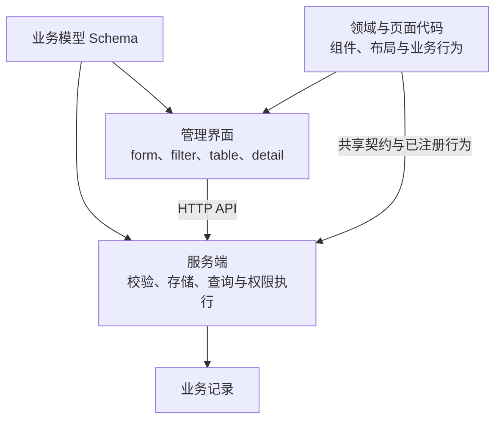

# ALIEN 项目介绍

> ALIEN 是一个模型驱动的泛数据管理系统（GDMS），通过定义数据模型，快速构建各类业务数据的管理应用。

| 名称           | 含义                                                 |
| -------------- | ---------------------------------------------------- |
| ALIEN          | 项目名称                                             |
| 泛数据管理系统 | 产品定位，也可解释为“通用数据管理系统”               |
| GDMS           | Generic Data Management System                       |
| Formwork       | 项目中承载模型协议、运行时与界面渲染等能力的核心框架 |

ALIEN 的目标是覆盖大多数常见业务数据的管理需求。“泛”指数据模型与管理能力能够跨业务领域复用：文章、客户、订单、组织、资产等业务对象，都可以用字段、约束、关系和层级描述，再接入共同的数据服务与管理界面。

## 减少业务系统中的重复开发

新增一种业务数据，通常意味着同时维护数据库结构、接口校验、录入表单、列表、筛选条件和详情页面。一个字段发生变化，多个位置都可能需要同步修改；随着模型增多，重复开发和规则不一致的问题也会累积。

ALIEN 将字段事实集中到一份 Schema 中，让前后端复用同一套定义。通用的数据管理能力由系统提供，业务开发围绕领域规则、特殊页面和业务操作展开。

| 使用者              | 可以获得的价值                                                            |
| ------------------- | ------------------------------------------------------------------------- |
| 业务应用开发者      | 复用记录 CRUD、字段组件、筛选、详情和权限执行，减少逐个模型搭建后台的工作 |
| 产品与业务团队      | 通过模型和预览讨论数据结构、字段含义与管理方式，更早发现定义上的分歧      |
| 数据维护人员        | 在统一的管理界面中录入、查询和维护不同类型的业务记录                      |
| AI Agent 集成开发者 | 通过 MCP 发现应用能力、读取模型、校验定义、保存草稿并生成预览链接         |

## 一份模型如何连接数据与界面

Schema 描述业务对象包含哪些字段、每个字段的值形态、约束、展示提示，以及模型之间的关系。服务端据此校验数据并生成存储和查询计划；前端根据相同字段定义，在不同场景中选择对应的组件。

图 1：模型定义在前后端复用，业务代码提供需要定制的部分。正式数据管理使用已发布模型，草稿可进入独立预览。

例如，客户档案可以包含姓名、联系方式、地址对象和多个地址组成的数组。通过模型表达这些结构后，系统能够复用字段校验、记录编辑、表格展示和详情查看。可用于筛选的字段与运算符，则由服务端根据字段类型、存储能力和当前权限返回。

页面布局和业务交互由代码组织。开发者显式注册 Domain 和 Page，在 Domain 中组合 Records、Detail、Editor 等 atom，也可以使用普通组件实现局部界面。

## 当前已具备的管理能力

以下能力以 2026 年 11 月 3 日的仓库实现为依据。

| 能力       | 当前范围                                                                               |
| ---------- | -------------------------------------------------------------------------------------- |
| 数据建模   | 字符串、数值、布尔值、对象、数组、枚举、默认值、必填与只读约束，以及模型内部的结构复用 |
| 关系与层级 | 模型间引用、单选与多选关系、自引用和树形数据描述                                       |
| 记录管理   | 创建、读取、更新、删除、分页、排序、按服务端能力筛选，以及模型和记录双版本条件写入     |
| 多场景界面 | form、filter、table、detail 共用字段定义；对象和结构化数组提供编辑与详情展示           |
| 权限执行   | 基于角色的操作授权、根字段访问控制，以及全部记录或本人创建记录的访问范围               |
| 模型演进   | JSON 编辑、草稿校验、内存预览、手动发布、不可变发布版本，以及修改和写入时的版本检查    |
| 业务扩展   | 共享字段格式与校验契约、自定义组件、领域能力、页面布局和已注册的服务端行为             |
| 程序访问   | HTTP 数据接口，以及面向模型管理的 MCP 工具                                             |

权限在服务端执行，界面中的显示、隐藏或只读状态用于表达当前操作体验。领域组件和页面定制同样遵守服务端的数据约束与授权结果。

当前应用使用 Cloudflare Worker 提供后端服务，使用 D1 存储数据。HTTP 数据接口可以供其他客户端调用，支持独立于管理界面的 headless 使用方式。

## 从模型定义到正式使用

ALIEN 将模型修改与正式生效分开，便于在调整业务结构时先检查定义和界面效果。

1. 定义模型：描述字段、约束、关系和需要的业务扩展。
2. 校验并保存草稿：检查定义中的问题；修改已有模型时保留稳定字段身份，并处理版本冲突。
3. 预览管理界面：用草稿体验表单、筛选、列表和详情，预览记录保存在当前页面内存中。
4. 发布模型：由有权限的用户在管理页发布，创建新的模型版本。
5. 管理业务记录：通过正式管理界面或 HTTP API 使用已发布模型。

发布时检查字段身份、存储和值契约兼容性。字段类型变化、嵌套结构调整、约束收紧或关系目标变化可能被拒绝，避免破坏已有记录。此次重构按未部署项目处理，不提供历史协议迁移。

AI Agent 可以参与前面的模型准备工作。现有 MCP 工具支持发现能力、读取模型、校验定义、保存草稿和生成预览链接；模型发布仍由用户在管理页完成。

## 可以承载的业务场景

仓库中的示例展示了同一套模型协议在不同业务对象上的使用方式。

| 场景                                                     | 示例中的数据结构                   | 可复用的管理方式                               |
| -------------------------------------------------------- | ---------------------------------- | ---------------------------------------------- |
| [内容管理](../examples/cms.definition.json)              | 标题、正文、标签等内容字段         | 录入内容、筛选记录、列表浏览和详情查看         |
| [订单数据](../examples/orders.definition.json)           | 状态枚举、金额、多选标签和明细数组 | 维护订单记录，编辑明细，按支持的字段条件查询   |
| [组织架构](../examples/departments.definition.json)      | 部门名称、父子关系和自引用         | 使用默认 list 维护，tree-list 仅演示当前页分组 |
| [客户档案](../examples/customer-profile.definition.json) | 联系方式、嵌套地址和多个地址       | 编辑结构化档案，复用公共地址定义，查看复杂字段 |

资产台账、产品目录、项目资料和配置数据等，也可以沿用同样的建模方式。是否适合接入，取决于其数据结构、查询方式和业务操作能否由现有能力及合理的领域扩展表达。

这些示例证明的是数据管理能力的复用。支付、履约、审批、财务结算等完整业务过程，需要额外的规则、操作和系统集成。

## 通用能力与业务定制的分工

ALIEN 以合理默认值降低普通场景的使用成本，同时为复杂场景保留代码定制空间。

| 需要表达的内容                         | 主要承载位置                              |
| -------------------------------------- | ----------------------------------------- |
| 字段类型、数据约束、关系和共享展示提示 | 模型 Schema                               |
| 某个业务分类共同使用的格式与校验       | app 和服务端共享的字段契约                |
| 字段组件和展示规则                     | app.components、app.ui 和 transformSchema |
| 模型布局、特殊页面与局部交互           | Domain、Page 和应用组件                   |
| 可信的服务端业务规则与操作             | 已注册的服务端行为与应用代码              |

应用显式声明 `defineFormwork({apis,components,ui,domains,pages})`。Domain 以 router 选择模型布局，Page 是固定路径的普通页面；schema.domain 仅保留业务分类。Schema 加工按 app → 当前 Domain → 局部执行，app 提供所有视觉组件和原生 CSS。

例如，内容领域可以扩展正文编辑组件，客户管理可以增加特定的联系方式展示方式，订单页面可以加入符合业务规则的操作。各项定制可以复用已有模型与记录能力。

## 当前适用边界

GDMS 的重点是可建模的业务记录及其日常管理。评估项目时，需要结合下面这些具体边界。

| 需求                           | 当前处理方式或边界                                                                               |
| ------------------------------ | ------------------------------------------------------------------------------------------------ |
| 常见结构化与嵌套数据           | 支持对象和数组；当前 D1 adapter 的关系及独立存储绑定主要作用于根字段，嵌套值以 JSON 保存         |
| 专业内容编辑                   | 已有 `richtext` 契约；当前默认实现按普通字符串保存，并以多行输入编辑，专业富文本体验需要扩展组件 |
| 复杂业务流程                   | 通过业务代码扩展；流程规则需要单独设计和实现                                                     |
| 多数据库与外部数据源           | 框架提供 FormworkApis；当前正式后端使用 D1，独立示例使用内存，其他服务需实现适配及后端约束       |
| 海量日志、时序分析、音视频处理 | 需要相应的专项存储和处理能力，不能由当前通用记录管理能力直接推导                                 |
| 企业级主数据治理               | 数据去重、主记录合并、跨系统分发等专项能力需单独评估                                             |

默认 list 是本次正式接入和验收的场景。tree-list、videos 仅用于展示布局组合，专业树形管理、媒体处理或富文本编辑可根据真实需求扩展。新项目接入可从[独立 headless 示例](../examples/headless/README.md)开始。

开发启动与部署方式见 [README](../README.md)；模型细节见[字段协议](schema-design.md)，代码定制方式见[运行时与代码归属](formwork-api-architecture.md)。
