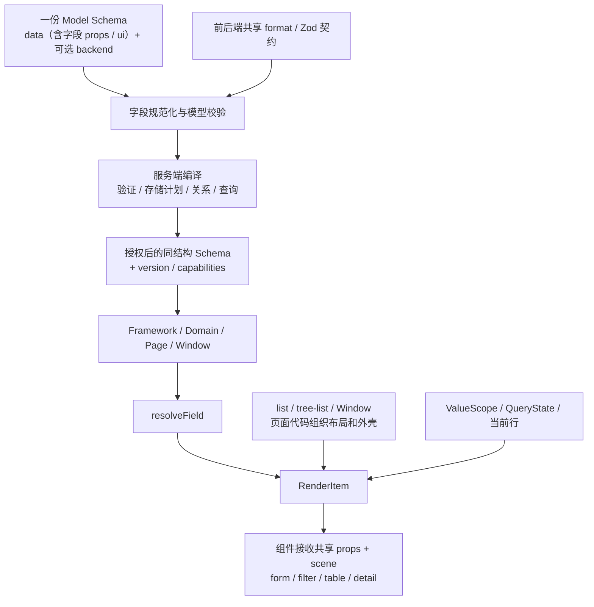

# 一份字段定义，推导 form、filter、table、detail

> 实施状态：已按本方案替换作者协议、共享 format / Zod、后端编译与查询、RenderItem 和公共场景组件。可运行示例见 `examples/`，准确 API 与实际目录见 `docs/schema-design.md`、`docs/formwork-api-architecture.md`，旧库显式升级步骤见 `docs/schema-migration.md`。下文保留设计依据与建议路径，实际采用同职责文件合并；没有保留持久化表达式执行器，动态 props 与业务联动在代码中提供。旧库迁移工具只生成诊断与事务计划，本次重构未执行真实数据库迁移。

状态：第三轮设计提案，已纳入六项补充及“布局完全由页面承载”的约束。本文的 Schema、format 注册表、`RenderItem` 和绑定接口均为待实现设计，不能直接作为当前版本的导入格式。代码目录建议基于当前 dev 分支核对，尚未实施重构。

## 1. 建议保留架构，重新确定字段协议的中心

`data` 是唯一的字段事实来源。字段级 `props` 供所有场景共享，`format` 选择带 Zod 契约的组件预设，`ui[scene].component` 保留场景覆盖。`RenderItem` 把字段、场景和当前值组合起来。页面布局完全由 list、tree-list 等 Page 及其 Window 的组件代码承担，Schema 不描述布局。

同一个字段定义一次类型、语义、约束、枚举和关系。后端用它校验、规划存储和计算查询能力；前端用它生成编辑器、查询控件、单元格和详情。Framework / Domain / Page / Window 的组织方式继续保留。

“一处定义”的目标是消除重复事实，不是消除所有配置。以下四种信息无法互相完整推导：

| 信息             | 例子                                            | 唯一归属                       |
| ---------------- | ----------------------------------------------- | ------------------------------ |
| 值是什么         | string、数组项类型、分类引用、枚举集合          | `data[field]`                  |
| 字段如何渲染     | type 的默认 format、format 的默认组件及配置约束 | 共享 format 契约与前端组件注册 |
| 多场景共有参数   | placeholder、clearable、maxTagCount             | `data[field].props`            |
| 这一次有什么不同 | 某场景改用 RadioGroup、某个 cell 使用特殊组件   | `ui[scene].component` 或调用处 |
| 当前实际能做什么 | 当前用户能否写入；当前数据库支持哪些 operators  | 服务端运行时能力               |

默认行为从字段与注册表推导，规范化结果不展开写回作者 Schema。六项补充及页面承载布局的要求按已确认需求处理；“无候选集合的多选如何输入”等尚未指定细节，在对应位置标为建议。

## 2. 作者直接写这一份 Schema

```json
{
  "schemaVersion": 1,
  "id": "article",
  "domain": "cms",
  "title": "文章",
  "data": {
    "title": {
      "type": "string",
      "title": "标题",
      "required": true,
      "minLength": 1,
      "maxLength": 120,
      "props": {
        "placeholder": "请输入标题",
        "maxWidth": 280
      }
    },
    "content": {
      "type": "string",
      "title": "正文",
      "format": "richtext",
      "props": { "minHeight": 240, "maxLines": 2 }
    },
    "status": {
      "type": "string",
      "title": "状态",
      "enum": [
        { "value": "draft", "label": "草稿" },
        { "value": "published", "label": "已发布" }
      ],
      "default": "draft"
    },
    "categoryId": {
      "type": "string",
      "title": "分类",
      "nullable": true,
      "format": "select",
      "relation": {
        "model": "category"
      },
      "props": { "placeholder": "选择分类", "clearable": true }
    },
    "tags": {
      "type": "array",
      "title": "标签",
      "format": "strings",
      "enum": ["产品", "技术", "运营"],
      "props": { "placeholder": "选择标签", "maxTagCount": 3 }
    },
    "seo": {
      "type": "object",
      "title": "SEO",
      "properties": {
        "description": {
          "type": "string",
          "title": "搜索摘要",
          "format": "text",
          "maxLength": 200
        }
      }
    }
  }
}
```

标题的 Input 读取 placeholder，table 展示读取 maxWidth；正文编辑器读取 minHeight，摘要读取 maxLines；多选编辑和 Tag 展示共同使用 maxTagCount。所有参数都只在字段上定义一次。

约定如下：

- `data` 直接是字段 map，省略恒为 object 的根节点外壳；嵌套对象仍使用 `properties`，数组使用 `items`。
- 根 `id` 是模型身份。字段内部的可选 `id` 是稳定字段身份，由管理端首次保存时补齐，普通作者不必填写。
- `schemaVersion` 是协议版本；模型的发布 `version`、草稿 `revision` 继续放在 API envelope 中。
- `domain`、`format`、`props`、`ui` 和物理存储例外均可省略；省略 format 时必须能由 type 和字段信息推导。不存在 Domain 时使用 Framework 默认行为。
- 协议不包含根 views、layout、pages 或布局节点树；页面、Window 的组织与呈现方式在代码中声明。
- 这是自己的字段协议，借用 JSON Schema 的类型和约束词汇，**不声称它是原生 JSON Schema**。通过一个编译器生成校验用 JSON Schema。

## 3. 字段只描述值，以及少量不能推导的事实

### 3.1 `format` 是带 Zod 契约的组件预设

| 配置                  | 含义                                           | 例子                                                        |
| --------------------- | ---------------------------------------------- | ----------------------------------------------------------- |
| `type`                | JSON 值的基本形态                              | `string`、`integer`、`number`、`boolean`、`object`、`array` |
| `format`              | 选择默认组件，并约束适用类型、必需配置和 props | `input`、`select`、`strings`、`richtext`                    |
| `ui[scene].component` | 某场景明确使用哪个组件                         | `RichText`、`RadioGroup`、`ArticleTitleCell`                |

解析顺序固定如下：

```text
type 确定实际值形态和基础默认值
  → 有 format：使用明确指定的预设
  → 无 format：Domain 默认推导，其后使用 Framework 推导
  → 规范化预设允许省略的配置
  → 运行完整字段及 format 的 Zod 契约
  → 找到预设的默认组件
  → 应用 ui[scene].component 和调用处覆盖
  → 注入共享 props、scene 和受控值
```

明确指定但不存在或不兼容的 format 必须报错，不能退回 type 默认组件。单次更换组件也不能绕过 format 的配置约束。

| 省略 format 时的字段             | 推导 format | 默认字段组件 |
| -------------------------------- | ----------- | ------------ |
| string                           | `input`     | Input        |
| number / integer                 | `number`    | NumberInput  |
| boolean                          | `boolean`   | Boolean      |
| 原子字段带 enum 或 relation      | `select`    | Select       |
| array，items 为 string           | `strings`   | Select，多选 |
| array，items 为 number / integer | `numbers`   | Select，多选 |
| array，items 为 boolean          | `booleans`  | Select，多选 |
| object                           | `object`    | ObjectFields |
| 其他结构化 array                 | `array`     | ArrayFields  |

推导时先处理具体形态，再落到普通 type 默认值：标量 enum / relation 优先于普通输入；array 的项类型规则优先于通用 select 规则。因此 string 引用数组推导为 strings，关系数据源仍然来自同一个 relation。

注册表的每项至少提供 `schema` 和 `component`。`schema` 是完整字段的 Zod 契约，可以检查 type、enum、relation 以及字段 props；`component` 是默认前端组件的注册名。必要时增加纯函数 `normalize` 补齐预设确定的结构，以及 `valueSchema` 约束实际值。

下面是 select 契约的示意片段；`baseFieldSchema`、`isSelectableShape` 属于拟实现的共享协议模块：

```ts
const selectFormat = {
  component: "Select",
  schema: baseFieldSchema.superRefine((field, ctx) => {
    const sources = Number(field.enum !== undefined) + Number(field.relation !== undefined);
    if (sources !== 1) {
      ctx.addIssue({
        code: "custom",
        path: ["format"],
        message: "select 必须且只能配置 enum 或 relation",
      });
    }
    if (!isSelectableShape(field)) {
      ctx.addIssue({
        code: "custom",
        path: ["type"],
        message: "select 只支持原子值或同类型原子值数组",
      });
    }
  }),
};
```

enum 还需要非空、类型一致和无重复校验；relation 还需要本地形状校验与服务端目标校验。它们继续是字段级协议属性，renderer 把规范化后的选项与关系能力提供给组件，不把它们藏进任意 UI props。

Zod 契约前后端共用；保存草稿时返回诊断，发布时阻止无效定义。组件实现只在前端注册，Zod 契约和组件名称可由无 UI 的共享模块导出。

本轮不再将 format 限定为内容编码。当前 CMS 的 RichText 实际是 textarea，保存普通字符串；新协议不能因为名字叫 richtext 就自动把历史值解释为 HTML。若未来组件输出 HTML 或结构化内容，需要在该 format 的数据契约中明确约定并处理迁移。

### 3.2 `strings / numbers / booleans` 直接描述原子值多选

```json
{
  "labels": {
    "type": "array",
    "format": "strings",
    "enum": ["技术", "产品", "运营"],
    "props": { "maxTagCount": 3 }
  },
  "scores": {
    "type": "array",
    "format": "numbers",
    "enum": [1, 2, 3, 4, 5]
  },
  "flags": {
    "type": "array",
    "format": "booleans"
  }
}
```

- 实际值分别为 `string[]`、`number[]`、`boolean[]`，所以 type 仍然是 array；`type: "string", format: "strings"` 应报错。
- 三种 format 分别补齐 string、number、boolean 的 items，不必重复手写。显式 items 可进一步约束，例如 numbers 的 `items: { "type": "integer" }`；冲突类型报错。
- form 默认使用 Select 多选，table 默认使用 TagList，detail 展示完整标签。table 不把这些原子值集合强制变成“点击详情”。
- 多选按原始类型保存，重复项非法；保留选择顺序。`false`、`0` 和空字符串不当作缺失。
- 建议：strings / numbers 没有 enum 或 relation 时使用支持创建选项的 Select；numbers 的输入转换成有限 number，非法文本不写入。存在候选源时只允许已有候选。
- booleans 无候选源时选项天然为 true / false，也可用 enum 限定子集。它最多保存两个不同值。
- 显式 `format: "select"` 仍要求 enum 或 relation。plural formats 的自由输入属于各自契约，不放宽 select 的规则。
- `maxTagCount` 只限制可见标签数量，溢出显示 `+N` 并可展开；不能截断实际保存的数据。
- 显式 `format: "array"` 可以让原子数组使用逐项编辑及复杂数组详情行为。

### 3.3 枚举既是合法值集合，也是选项来源

以下两种写法都允许；原始值是 `{ value, label }` 的简写，编译时统一归一化：

```json
{
  "answer": {
    "type": "string",
    "title": "是否确认",
    "enum": ["是", "否", null]
  },
  "status": {
    "type": "string",
    "enum": [
      { "value": "draft", "label": "草稿" },
      { "value": "published", "label": "已发布" }
    ]
  }
}
```

- 记录只保存原始 `value`，不保存选项对象。
- enum 非空且只支持原子值。标量字段按自身 type 校验成员；数组字段按 items 校验成员。值不得重复，`1` 和 `"1"` 不相等。
- 标量 enum 是完整允许集合：包含 null 才允许 null。此时不再同时声明 nullable，避免维护两份空值定义。
- 其他字段使用 `nullable: true` 允许整个字段为 null，默认不允许。
- 数组的候选也统一写在字段 `enum`，它约束每个数组项；不同时支持第二份 `items.enum`。这属于自有协议语义，编译时落到 JSON Schema 的 items.enum。
- strings / numbers / booleans 的候选不能包含 null。数组自身是否可为 null 由 nullable 决定，与数组项候选无关。
- 多选由 type / format 推导，不补写 `multiple: true`。
- `label` 是展示信息，改变 label 不改变记录的值。原始值简写按值显示，null 使用框架可本地化的“空值”标签。

例如 `type: "string" + enum: ["是", "否", null]`，form 默认就是 Select；查询场景还需要把“未启用条件”和“筛选 null”区分开。

### 3.4 `required`、null、空字符串各有独立含义

`required: true` 表示对象中必须存在该属性；null 是否合法由上一节决定。`required: true` 本身不禁止 `""`，非空文本需要 `minLength: 1`。

| 输入状态  | 创建记录                     | 部分更新     | 筛选             |
| --------- | ---------------------------- | ------------ | ---------------- |
| 属性缺失  | 应用 default 后检查 required | 保留已有值   | 没有该条件       |
| 显式 null | 检查是否允许 null            | 写入 null    | 表示空值条件     |
| 空字符串  | 按字符串约束验证             | 写入空字符串 | 是一个实际查询值 |

`default` 只在创建新值或显式插入新数组项时应用。加载已有记录、表格渲染和 filter 不应用 default。缺失的可选对象不会仅因子字段有 default 而自动生成。

删除已有属性应使用明确的 unset 操作，不能用 null 冒充删除。完整记录应保留缺失与 null 的区别；如果某个 SQL adapter 无法直接表达这一差异，由它维护必要的存在性信息，不能在返回时把非 nullable 的缺失字段统一改成 null。

### 3.5 关系只定义一次，数据保留原始引用值

```json
{
  "categoryId": {
    "type": "string",
    "relation": {
      "model": "category",
      "valueField": "/id",
      "labelField": "/name"
    }
  },
  "relatedArticleIds": {
    "type": "array",
    "format": "strings",
    "relation": {
      "model": "article",
      "labelField": "/title"
    }
  }
}
```

- `valueField` 默认 `/id`，`labelField` 默认 `/name`，均为目标模型的 JSON Pointer；目标字段不存在时要求显式配置，不猜另一个字段。
- 标量是单引用；数组是多引用。不再重复声明 `kind`、`multiple` 或关系控件的数据源。
- 源值类型必须与目标 `valueField` 匹配；目标值必须唯一。多引用数组中的引用值不得重复，不包含 null 项。
- 同一字段不能同时声明 enum 和 relation；多引用字段的 `items` 也不能再声明 enum。两者都是候选集合的来源，不能让组件按优先级掩盖相互冲突的定义。
- 记录保存 `"category-1"` 或 `["article-1", "article-2"]`。label 通过独立的解析服务获取，避免把 `{$ref, value, label}` 混进业务值。
- 搜索选项与已有值回显共用关系服务。table 按模型、目标字段和值批量解析并缓存，避免每个单元格分别请求。
- 关系能力不意味着可以读取目标模型所有字段；选项与回显接口都遵守目标模型权限。

`relation` 在第一版表示业务引用，不承诺数据库一定创建外键或 join table。实际存储方式由 adapter 推导；特殊关系存储可通过 `storage` 例外指定。

### 3.6 对象、数组、复用和字段地址

- 对象使用 `properties`；字段自己的 `required` 在编译时提升为父对象的 JSON Schema `required` 数组。通用 array 必须提供 items；三种 plural formats 可以按契约省略。
- 第一版对象默认封闭，拒绝未声明属性。需要开放字典时，显式使用 `additionalProperties` 的字段 Schema。
- `minLength / maxLength / pattern`、`minimum / maximum`、`minItems / maxItems / uniqueItems` 等保留熟悉的约束语义。
- 可选根 `$defs` 保存可复用的字段定义，使用本地 `$ref: "#/$defs/Address"` 引用。引用处可覆盖 `title / description / required / readOnly / props / ui` 等使用点注解；不能同时用另一份 `type / format / properties / items / enum` 覆盖被引用的契约。
- `$defs` 不携带物理字段 id；引用使用点可以拥有自己的 `id`，稳定存储身份属于实际字段使用点。第一版不支持远程 `$ref`。
- 字段寻址使用 JSON Pointer，例如 `/seo/description`。数组内通过 item scope 使用相对 Pointer，例如 `/heading`。
- 数组项的稳定 key 决定组件身份，实际值地址随排序更新；记录路径只由对象和数组的数据结构决定。
- 页面默认可按字段声明顺序遍历，也可以在代码中选择和排序字段；需要固定顺序时由页面明确声明，不增加布局 Schema。

协议的常用部分保持很小。多态对象等尚未约定的高级结构应单独设计，不能只接受一个 JSON Schema 关键字、却让校验器、存储和 renderer 各自理解。

## 4. 每个字段组件明确接收 `scene`

默认组件可以在内部根据 scene 选择编辑器、查询控件或只读展示。需要单独的场景组件时，通过 `ui[scene].component` 替换；两种方式使用相同的 props 契约。

下面的组件是目标能力，尚未全部实现：

| 有效 format                  | 默认字段组件 | form                       | filter（后端支持时）        | table           | detail         |
| ---------------------------- | ------------ | -------------------------- | --------------------------- | --------------- | -------------- |
| input                        | Input        | 文本输入                   | 文本条件                    | 文本 cell       | 文本           |
| text                         | TextArea     | 多行输入                   | Input                       | Tooltip 摘要    | 保留换行       |
| richtext                     | RichText     | 编辑正文                   | Input                       | 摘要 + Tooltip  | 按契约显示正文 |
| number                       | NumberInput  | 数值输入                   | 按 operator 选择单值 / 范围 | 数值 cell       | 数值           |
| boolean                      | Boolean      | Switch，nullable 时 Select | Select                      | 布尔标记        | 布尔文本       |
| select，标量                 | Select       | 本地 / 远程单选            | 按 operator 单选 / 多选     | 候选 label      | 候选 label     |
| select，数组                 | Select       | 本地 / 远程多选            | 按 operator 适配            | TagList         | 完整标签       |
| strings / numbers / booleans | Select       | 多选                       | 按集合 operator 适配        | TagList         | 完整标签       |
| date / date-time             | DateField    | 日期输入                   | 单值 / 范围                 | 日期 cell       | 日期文本       |
| object                       | ObjectFields | 子字段                     | 通用 operand 编辑器         | 摘要 + 详情按钮 | 递归详情       |
| array                        | ArrayFields  | 明细项                     | 通用 operand 编辑器         | 数量 + 详情按钮 | 递归详情       |

对象和结构化数组默认没有查询能力；一旦后端提供支持，filter 就必须显示。operator 契约同时提供 operand 结构，缺少专用控件时使用通用 operand 编辑器，不能因组件缺失把已支持的条件静默隐藏。

组件公共属性的核心示意：

```ts
type FieldScene = "form" | "filter" | "table" | "detail";

type FieldComponentProps = {
  scene: FieldScene;
  field: FieldDescriptor;
  value: JsonValue | undefined;
  onChange?: (value: JsonValue | undefined) => void;
  readOnly: boolean;
  disabled: boolean;
  errors: readonly ValidationIssue[];
  operator?: string;
  operandSchema?: DataSchema;
};
```

组件还会收到字段的共享 props，以及按需提供的选项、关系、数组和详情能力。filter 的 operator 和 operandSchema 由绑定提供，multiple 根据 operand 契约决定；其他场景按字段形态决定。`scene` 是必需的受控属性，不能用 props 覆盖；`readOnly` 独立表示交互限制，不能代替 scene。只读 form 仍然是 form，可编辑 cell 仍然是 table。

例如 RichText 可以在内部选择：

```tsx
const RichText = (props) => {
  switch (props.scene) {
    case "form":
      return <RichTextEditor {...pickEditorProps(props)} />;
    case "filter":
      return <Input {...pickFilterProps(props)} />;
    case "table":
      return <TooltipCell {...pickSummaryProps(props)} />;
    case "detail":
      return <RichTextViewer {...pickViewerProps(props)} />;
  }
};
```

`pick…Props` 表示组件只读取自己支持的属性。没有要求必须实现这些函数，也不把整包字段 props 透传到 DOM。

DetailCell 保留原始 record、字段路径和 Domain 上下文，弹窗内使用 detail 场景递归渲染。普通对象与结构化数组使用它；原子值多选数组优先使用 TagList。

### Domain 注册预设，组件内部处理日常场景差异

```ts
const cmsContract = {
  formats: {
    richtext: {
      component: "RichText",
      schema: richTextFieldSchema,
    },
  },
};

const cmsDomain = {
  ...cmsContract,
  components: { RichText },
  fn: { saveRecord: saveCmsRecord },
};
```

这些是拟新增的注册形状。`cmsContract` 为前后端共享的无 UI 模块；`cmsDomain` 属于前端应用装配。Domain 可提供纯 `inferFormat` 覆盖默认推导，服务端与客户端使用同一契约。Page / Window 可以覆盖组件实现，但不改变持久化值的类型或格式契约。

## 5. 字段级 `props` 共享，`ui` 只覆盖场景组件

```json
{
  "type": "string",
  "title": "状态",
  "enum": [
    { "value": "draft", "label": "草稿" },
    { "value": "published", "label": "已发布" }
  ],
  "props": {
    "placeholder": "选择状态",
    "clearable": true,
    "compact": true
  },
  "ui": {
    "form": {
      "component": "RadioGroup"
    },
    "table": {
      "component": "StatusCell"
    }
  }
}
```

字段 `props` 只维护一份。form、filter、table、detail 组件各取所需；新增组件也从同一个入口读取。`ui.table.props`、`ui.filter.props`、decorator 和 decoratorProps 不进入新协议，发布时返回明确诊断。

每个场景覆盖只允许：

| 键               | 含义                   |
| ---------------- | ---------------------- |
| `component`      | 具名值组件             |
| 场景值为 `false` | 不参与该场景的自动生成 |

FormItem、FilterItem 等外壳由页面或公共场景组件在代码中选用，不通过 Schema 选择。它们需要的 labelWidth、help 等仍可读取字段级 props。属性名在共享契约中含义一致；不同含义使用不同名字，例如 editorMinHeight 和 maxLines。

`format` 承担类似 x-component 的默认选择能力，并增加 Zod 校验；`ui[scene].component` 负责场景例外。无需再增加顶层 x-component 作者语法。

覆盖顺序从低到高：

```text
组件名称：有效 format.component → field.ui[scene].component → 本次显式 component
具名实现：Framework → Domain → Page → Window
共享 props：组件默认 → format 默认 → Domain / Page / Window 默认 → field.props → 本次 props
```

Page / Window 及单次覆盖仅作用于当前实例。页面自己的 JSX/CSS 负责容器、分栏和排版；字段展示参数放在字段 props，代码调用处的临时覆盖不展开存回 Schema。

合并规则必须可预测：

1. 未提供的键继承，props 浅合并，数组整体替换。
2. 替换组件后重新使用新组件的默认 props，但保留字段共享 props；新组件只消费自己支持的键。第一轮“换组件清除共享 props”的规则在本轮取消。
3. enum 选项、relation、multiple、value、onChange、scene、field 和权限状态由 renderer/adapter 提供，不能在字段 props 中伪造。
4. Zod 校验已知 props 的值，保留其他注册组件使用的扩展属性；不因某个组件不认识某个键而删除它。已知但类型错误的属性仍须报错。
5. 修改 label、枚举候选或关系来源仍修改字段本身，不在 props 另写一份 options。组件展示候选子集时使用具名能力，不能改变合法值集合。
6. `false` 是明确的界面隐藏覆盖；不填时 filter 和 table 全部按有效后端能力生成。权限限制始终独立生效。
7. 持久化 props 必须是 JSON；函数和响应式值只在代码调用处使用。

例如 Select 换成 RadioGroup，placeholder 仍可留在共享 props 中供 filter 的 Select 使用；RadioGroup 不读取它。两者继续共享同一份 enum。

## 6. filter 与 table 默认完整展示后端支持的字段

服务端根据字段、存储 adapter、已注册的查询实现和当前权限求出有效能力。以下是新运行时 envelope 的形状示例，不是另一份作者 Schema：

```json
{
  "version": 12,
  "capabilities": {
    "fields": {
      "/title": {
        "read": true,
        "filter": ["eq", "contains"],
        "sort": true
      },
      "/content": {
        "read": true,
        "filter": ["contains"],
        "sort": false
      },
      "/status": {
        "read": true,
        "filter": ["eq", "in"],
        "sort": true
      },
      "/categoryId": {
        "read": true,
        "filter": ["eq", "in", "isNull", "isNotNull"],
        "sort": false
      },
      "/tags": {
        "read": true,
        "filter": [],
        "sort": false
      }
    }
  }
}
```

同一 envelope 还携带授权后的 `schema`；此处只展开能力部分。

```text
可自动生成 filter
  = 字段对当前用户可见
  ∧ capabilities 中至少一个 operator 可用
  ∧ ui.filter !== false

可自动生成 table 列
  = 后端可返回且当前用户可读的根字段
  ∧ ui.table !== false
```

- 默认不排除 id、readOnly、对象和数组，也不要求逐字段写 filter:true / table:true。对象按整字段显示详情入口，避免自动展开出大量叶子列；需要叶子列时由页面代码显式引用。
- table 展示能力与 filter / sort 分开：不可筛选、不可排序的字段仍可展示。strings / numbers / booleans 显示 Tag，其余复杂对象与数组显示可点击的详情入口。
- filter 不再因 readOnly 或前端预设类型列表排除字段，后端返回支持就生成。嵌套字段的查询能力按具体路径返回。
- 未返回能力，按不支持处理。`ui.filter.component` 不能让后端不支持的字段变得可查询；详情也只能读取同一授权记录投影。
- Domain 从允许的 operators 中选择默认项。例如文本优先 contains，枚举优先 eq；指定 operator 不被允许时给出诊断。
- operator 决定 operand 形状：`eq` 是单值、`in` 是集合、`between` 是范围、`isNull` 无 operand。组件也必须按 operator 适配；数组的 containsAny 等集合操作使用独立契约，不能把它误解成字符串 contains。
- 内建 operator 契约前后端共享；后端扩展的 operator 必须同时提供可序列化 operand Schema，由专用组件或通用 operand 编辑器呈现。它与字段 format 的记录输入契约分开。
- 如需明确禁止服务端查询，可以写字段 `query: { "filter": false }`；禁止排序使用 `query: { "sort": false }`。`ui.filter: false` 只影响界面。
- 如果支持对象子字段或数组查询，由 adapter 返回相应路径和 operators；前端不因基础类型自行承诺支持。
- capabilities 与模型发布版本绑定。查询提交后，服务端仍按当前身份重新检查权限与能力。

FilterBinding 保存独立的 `active / operator / operand`，不能直接把完整记录 Schema 塞进一个 form scope：

```json
{
  "field": "/categoryId",
  "active": true,
  "operator": "isNull"
}
```

清空条件会移除 clause；选择 null 会生成已授权的 `isNull` 条件。这两个操作不同。filter 不运行记录 required、default 和写入联动，operand 由对应 operator 的契约校验。

format 的名称不能证明查询实现存在。若未来 richtext 保存 HTML，后端需要明确 contains 的语义；纯文本搜索尚未实现时，不能把 HTML 源码 LIKE 查询当成等价能力。

## 7. `RenderItem` 统一字段渲染，状态通过适配器接入

建议拆出两个足够深的公共能力：

| API                                 | 责任                                                         |
| ----------------------------------- | ------------------------------------------------------------ |
| `resolveField(field, context)`      | 消费已规范化 format，统一完成组件覆盖、共享 props 合并和诊断 |
| `RenderItem({ field, scene, ... })` | 接入当前值或 binding，向字段组件注入 scene                   |

公共渲染接口以 RenderItem 为核心，不再提供 Schema View 布局树解释器。页面或公共 RecordForm、FilterBar、RecordTable 负责遍历字段和组织容器，每个字段使用同一个 RenderItem。

### `field` 是无状态描述，不是持有 value 的控件实例

`ctx.model.field("/content")` 返回字段的已解析 Schema、有效 format、共享 props、身份和有效能力。相同描述可以同时用于多个记录、多个场景，不在描述中存储当前 value 或 errors。

以下都是待新增 API 的调用示意：

```tsx
const contentField = ctx.model.field("/content");

// 表单从独立 scope 取得可编辑绑定。
<ctx.RenderItem field={contentField} scene="form" binding={ctx.scope.field("/content")} />;

// Table 直接提供当前行的值，不为每个 cell 建一个 form scope。
<ctx.RenderItem field={contentField} scene="table" value={record.content} record={record} />;

// Filter 使用独立查询状态与 operator 契约。
<ctx.RenderItem field={contentField} scene="filter" binding={query.field("/content")} />;

// 调用处可以只覆盖这一个单元格。
<ctx.RenderItem
  field={contentField}
  scene="table"
  value={record.content}
  record={record}
  component="ArticleExcerptCell"
  props={{ maxLines: 2 }}
/>;
```

可以直接封装用户需要的 TableCell：

```tsx
const TableCell = (props) => (
  <ctx.RenderItem
    field={props.field}
    scene="table"
    value={props.value}
    record={props.record}
    component={props.component}
  />
);
```

接口规则：

- `value` 与 `binding` 二选一。binding 封装响应式读取、写入、errors、readOnly，以及当前值地址。
- form 通常接 ValueBinding；filter 必须接 FilterBinding；table/detail 默认直接读 value。
- 可编辑表格可以显式使用 ValueBinding 和编辑组件，无需另建一套单元格字段协议。
- 核心 renderer 只依赖绑定契约；现有 ValueScope 是默认适配器，也允许其他状态管理方案实现该契约。
- 组件通过注册适配器接收统一的 scene 和受控 props。接入第三方组件时，适配器处理场景表现、支持的 props 与事件格式，框架不把整包 props 直接传给原生 DOM。
- Schema 的 `readOnly`、父 scope 限制和当前权限共同约束写入；props 不能解除限制，服务端仍负责最终校验。
- RecordForm 在代码中使用 FormItem，FilterBar 使用 FilterItem，RecordTable 使用表格单元格外壳。RenderItem 专注字段组件；页面可以替换外壳，无需改动 Schema。
- 渲染本身不注册业务字段写入副作用。同一个字段出现在 form 和 table，不能导致计算执行两次。

最后一点对应当前实现值得调整的边界：`bindings.value` 目前随渲染创建计算绑定。业务计算应该属于独立 scope / 数据引擎，服务端写入执行相同业务规则。显示、禁用等展示联动可以留在渲染层。

### 页面完全承载布局

| 页面或组件                 | 在代码中承担的职责                                          |
| -------------------------- | ----------------------------------------------------------- |
| list                       | 组织筛选区、表格、分页、工具栏与记录 Window                 |
| tree-list                  | 组织树与列表的分栏，选择节点后将查询条件交给共享 RecordList |
| 新建/编辑 Window           | 组织字段分组、排列、提交与取消按钮                          |
| 详情 Window                | 组织字段展示及详情外壳                                      |
| ObjectFields / ArrayFields | 根据 properties / items 递归渲染数据，组件自己决定内部排版  |

同一个模型在 list 和 tree-list 中使用同一份字段 Schema，页面差异全部由各自的组件代码表达。页面选择、路由和 Window 的 page/drawer/modal 呈现方式也在现有 Page/Window 定义中处理。

ObjectFields / ArrayFields 的递归仅来自实际数据结构；不会构造另一棵 Grid、Tabs、Card 或 void 节点树。若保留模型的 tree.parentField / labelField，它们只描述数据层级和名称，不决定页面布局。

因此从协议及目标接口中移除 views、布局用 ViewNode/RuntimeView、RenderProps.view、布局 children AST 和 schema.pages。公共组件复用通过代码组合实现，字段顺序与分组由所在页面决定。

## 8. 后端编译产物不再要求作者手填



数据流中，共享契约先完成 format 推导、结构补齐与配置校验。服务端生成实际能力，页面代码组织布局，RenderItem 绑定组件和当前状态；不会从 UI 组件名称反推数据库类型。

### 同一作者协议，按职责消费和投影

- `type / format / enum / relation / constraints`：前后端共享。
- `props / ui`：前端消费；后端发布时使用共享契约检查字段配置及组件引用合法性。
- 可选 `backend`：保留模型级权限、可信业务规则引用和特殊存储设置。
- 可选字段 `storage`：只保存不能从字段推导的物理例外，例如固定列名或 unique index。
- SQL type、JSON encoding、relation plan、字段查询能力等由编译器生成，不手写到每个字段旁边。

“前后端共用”并不要求把完整管理定义发送到浏览器。普通客户端接收同一字段结构的授权投影，剔除 backend 和无权限字段；管理接口继续使用完整定义。投影不是第二份人工维护的字段模型。

编译校验时：

1. 把 `data` 包成 JSON Schema 的根 object，解析本地 `$ref`。
2. 运行共享 format 推导和 Zod 配置契约，补齐 plural formats 的 items。
3. 把字段 required 汇总到父对象，把 enum 选项归一成原始值；数组的 enum 编译到 items.enum。
4. 根据标量 enum 的 null 或字段 nullable 生成合法类型联合，校验 default、数据约束、关系目标和所有字段引用。
5. 生成当前 adapter 的存储与查询计划；不能支持的物理语义在发布阶段报错。

### 字段身份、改名和发布仍然是显式能力

- 首次保存补齐稳定字段 id。字段名称变更不改变 id，从而保留物理列身份。
- 顶层标量、对象或数组的实际存储由 adapter 决定；不能仅凭“嵌套字段改名”就假定 JSON 数据也已迁移。
- 删除、拆分、类型变化、嵌套路径变化需生成迁移诊断；禁止静默丢弃已有数据。
- 关系的易读路径在编译时解析为稳定目标身份。跨模型改名必须验证和迁移相关引用，不能靠默认 `/name` 继续猜测。
- 草稿允许保存暂时不完整的定义；发布才要求完整有效，继续保留 revision、不可变发布版本及权限投影。
- Domain 默认值随应用代码版本变化。改变值编码、校验或查询语义需要兼容性检查或显式迁移；单纯替换展示组件无需改写全部模型。

## 9. 按当前架构整理代码归属

以下“当前”与“main”是本次仓库检查得到的事实；“提案”是建议的下一步。

| 来源     | 已有值得保留的能力                                                                     | 本提案如何组合                                                        |
| -------- | -------------------------------------------------------------------------------------- | --------------------------------------------------------------------- |
| Formily  | headless 字段状态、可插拔 component/decorator、数据路径与布局地址分离、联动能力        | 借鉴字段与渲染解耦；业务规则独立于组件挂载，场景通过统一解析接入      |
| main     | 字段携带 type、relation、form/table/filter；SchemaComponent 复用；远程选项与复杂值详情 | 保留共享组件、关系推导和详情；改用显式 scene 和统一字段 props         |
| 当前分支 | Framework / Domain / Page / Window、独立 ValueScope、可选 View、草稿/发布/授权投影     | 保留 Page/Window 和数据生命周期，移除 View 协议；增加共享 format 契约 |

Formily 的 headless 状态、字段适配和联动能力仍有参考价值。本项目由页面代码承载布局，不引入它的布局 Schema 或 void 节点体系；字段协议专注跨场景复用、关系、查询能力及存储契约。

### 9.1 通用协议、运行时、UI 和业务各有明确位置

当前 `formwork/model` 已经是服务端使用的独立出口，应继续保持无 Solid、DOM 和 UI 依赖。`packages/formwork` 内部完成协议、状态和 renderer；带样式的组件属于 client；共享 Domain 契约需要前后端都能导入。

```text
packages/
  formwork/src/
    model/
      field/                  # 字段类型、Zod、format 预设、规范化
      document-schema.ts      # 模型及字段引用校验
      backend-schema.ts       # 管理定义与权限结构校验
      snapshot-schema.ts      # draft / published / runtime envelope
      validation.ts           # 记录值校验和 JSON Schema 编译接入
      pointer.ts              # 路径处理
      http.ts                 # 前后端数据接口
      index.ts                # 保持 formwork/model 公共出口
    runtime/
      scope.ts                # ValueScope 与稳定数组项
      query.ts                # 独立 FilterBinding / QueryState
      relation-options.ts     # 选项搜索、批量回显和请求去重
      instance.tsx            # Domain / Page / Window 生命周期装配
    render/
      resolve-field.ts        # 组件选择与共享 props 合并
      render-item.tsx         # 单字段绑定与受控 scene 注入
      index.ts                # 导出字段渲染能力，不提供布局解释器
    router/                   # 延续现有路由实现
    mcp/                      # 协议导出、诊断与工具接入
  domain-contracts/src/
    cms.ts                    # cms 的共享 format 与 Zod 契约
apps/
  client/src/
    components/
      ui/                     # SelectControl、Modal、Tag、Tooltip 等基础 UI
      fields/                 # Input、Select、RichText、Object、Array 字段组件
      fields/containers/      # FormItem、FilterItem、TableCell、DetailItem
      records/                # FilterBar、RecordTable、Pagination、RecordList
    formwork/
      defaults.ts             # 默认组件及 Domain 装配
      api.ts                  # 后端 API Adapter
      data/                   # 记录资源加载、刷新与提交协调
      fn/                     # 应用行为函数
      presenters/             # page / modal / drawer 宿主
      shell/                  # 应用导航、顶部栏与外壳
    domains/cms/              # cms 前端注册、业务行为及真正专有 UI
    pages/                    # 路由、页面组合与 Window 声明
  service/src/
    domains/                  # 导入共享领域契约，装配服务端行为
    application/              # 模型发布、记录操作、权限与事务协调
    adapters/d1/compiler/     # 存储计划、关系计划和查询编译
    adapters/d1/repositories/ # 数据访问
    http/                     # HTTP / MCP 入口与错误转换
```

这是职责结构，不要求每个短函数单独建文件。新增 `domain-contracts` 是因为 client 与 service 都需要同一领域 Zod/format 定义；它只依赖共享 model 契约，不依赖任一 app、UI 或数据库。以一个 CMS 契约文件开始即可。

组件放在 `apps/client/src/components`，让 Page、Window、Domain 都能使用。当前只有一个前端应用，不先拆一个额外 UI package。`formwork` 保持组件库无关，不直接引入 Kobalte、Tailwind 或 CMS 编辑器。

依赖规则：

```text
formwork/model ← domain-contracts ← client / service 的领域装配
formwork/model ← formwork/runtime / render
client/components/ui ← client/components/fields ← client/components/records
components + formwork 装配 ← pages / domains
service/adapters ← service/application ← service/http
```

箭头表示“右侧使用左侧”；应用组装可以注入依赖，但 model 契约不得反向导入 app。service 的数据库实现可以使用 model 类型，不能决定前端组件 props。

### 9.2 现有代码的具体去向

下表源路径均已核对；目标路径为重构建议。

| 当前代码                                                                 | 实际职责或问题                                                            | 建议去向                                                                                                                               |
| ------------------------------------------------------------------------ | ------------------------------------------------------------------------- | -------------------------------------------------------------------------------------------------------------------------------------- |
| `packages/formwork/src/model/schema.ts`                                  | 同时承担字段/文档检查、backend/envelope 校验、defaultComponent、View 校验 | 字段及 format 进入 `model/field`，管理/envelope 独立；移除布局 View 校验，保留字段引用检查                                             |
| `packages/formwork/src/model/presentation.ts`                            | 混合字段寻址、顺序和场景展示覆盖                                          | 字段寻址保留在 model，展示顺序由页面代码决定，场景组件覆盖进入 render                                                                  |
| `packages/formwork/src/render/render.tsx`                                | 同时遍历树、推导组件、绑定表达式、写值及套容器                            | 移除布局树解释器；单字段逻辑进入 `render-item.tsx`，推导/合并进入 `resolve-field.ts`，外壳由页面/公共场景组件组合                      |
| `packages/formwork/src/render/default-view.ts`                           | 生成默认 View 节点与对象子视图                                            | 移除 View 生成；实际对象/数组子字段遍历由字段描述与对应字段组件完成                                                                    |
| `packages/formwork/src/model/types.ts`、`runtime/types.ts`               | 包含 ViewNode、RuntimeView、RenderProps.view 及 schema.pages              | 移除布局相关契约，保留 Page/Window 代码声明、字段描述和场景组件覆盖                                                                    |
| `packages/formwork/src/runtime/expression.ts`                            | 值计算与组件挂载生命周期耦合                                              | 业务写值由 scope 管理；只读展示表达式继续供 renderer 使用                                                                              |
| `apps/client/src/formwork/components/fields.tsx`                         | 多种控件集中；Select 内硬编码 paid/pending 文案                           | 按字段能力迁入 `components/fields`；业务文案转为模型 enum labels，特殊样式转为业务组件                                                 |
| `apps/client/src/formwork/components/index.tsx`                          | 默认组件注册                                                              | 注册表回到 `formwork/defaults.ts` 附近；字段组件目录只导出实现                                                                         |
| `apps/client/src/formwork/field-container.tsx`                           | 标签、容器、复杂值摘要、场景 Context 混在一起                             | 外壳进入 `components/fields/containers`，由公共场景组件选用；详情能力单独提取；取消 `useCompactCell`，直接读取 scene                   |
| `apps/client/src/formwork/shell/select.tsx`                              | 通用 SelectControl                                                        | `components/ui/select.tsx`                                                                                                             |
| `apps/client/src/formwork/shell/window.tsx`                              | Modal 等可复用窗口 UI                                                     | `components/ui`；presenters 继续在 formwork 中绑定 Window 生命周期                                                                     |
| `apps/client/src/formwork/shell/json-editor.tsx`、`resizable-panels.tsx` | 可复用编辑器和面板                                                        | `components/ui`，保留已有惰性加载                                                                                                      |
| `apps/client/src/domains/cms/components/rich-text.tsx`                   | 当前只有通用字符串编辑，没有 CMS 业务依赖                                 | 迁入 `components/fields/rich-text.tsx`；CMS 只注册预设和业务默认                                                                       |
| `apps/client/src/domains/cms/model.schema.ts`                            | 目前只在 client 定义领域约束                                              | 共享部分进入 `packages/domain-contracts/src/cms.ts`，client 与 service 共同使用                                                        |
| `apps/client/src/pages/list/content.tsx`                                 | 自行推导列/filter/sort、构造 querySchema、加载记录并渲染全页              | 推导进入共享 model/query；资源协调进入 `formwork/data`；Filter/Table/Pagination 进入 `components/records`；Page 保留导航和 Window 行为 |
| `apps/client/src/pages/list/field-detail.tsx`                            | 可用于任意复杂字段的弹窗详情                                              | `components/fields/field-detail.tsx`，接收字段、记录和 renderer，不接收完整 PageContext                                                |
| `apps/client/src/pages/tree-list/content.tsx`                            | 直接导入另一个 Page 的 List                                               | 改为与 list Page 共同使用 `components/records/RecordList`；树构建保留在本页辅助模块                                                    |
| `apps/client/src/pages/list/window/record-editor.tsx`                    | 同时组织字段、校验、保存和 Window 完成                                    | 字段布局/按钮提取可复用 RecordForm；保存、失败处理和 complete 继续归 Window 行为                                                       |
| `apps/client/src/pages/models/model-detail.tsx`                          | 管理页面内部逻辑较多，但尚不是通用能力                                    | 按页面内部的编辑/诊断/发布职责拆在 `pages/models` 内，不直接搬进公共 UI                                                                |
| `apps/service/src/application/model-validation.ts`                       | 同时检查配置、关系目标、权限、物理存储                                    | 通用配置校验改用共享 Zod/format；数据库与权限校验继续留在 service                                                                      |
| `apps/service/src/adapters/d1/compiler/storage.ts`                       | 物理存储及迁移计划                                                        | 保留；增加从新字段协议生成 bindings/relations 的编译阶段                                                                               |
| `apps/service/src/application/capabilities.ts`                           | 现有能力主要是组件/fn/路由的静态清单                                      | 保留用途；记录的 read/filter/sort 能力由查询编译结果和权限交集生成，不混用概念                                                         |
| `packages/vite-plugin/src` 与 `packages/formwork/src/mcp`                | 静态能力提取、协议说明和工具校验                                          | 同步识别 format 注册与共享 props；MCP schema 从同一字段契约派生，保留运行时检查标记                                                    |

Zod 的 superRefine 和异步关系检查不一定能完整导出为 JSON Schema，MCP 需要保留相应诊断入口，不能宣称静态工具 Schema 已覆盖全部发布校验。

### 9.3 公共组件承担重复行为，页面保留业务选择

建议提取的公共能力有明确使用场景：

- Select 字段：统一 enum / relation / 自由多选、原始类型保持，以及 table 的 label / Tag 展示。
- TagList、TooltipCell、DetailCell：供默认字段组件与 Domain 组件使用。
- FieldDetail：供 object、结构化 array 及业务复杂值组件打开详情，并恢复触发元素焦点。
- FilterBar、RecordTable、Pagination、RecordList：由 list 和 tree-list 共同使用，页面传入动作。
- RecordForm / RecordDetail：复用字段排版，Window 保留保存、取消、完成及当前生命周期。

Select 的远程选项实现可以是内部 RemoteSelect Adapter，不需要 Schema 重复配置 model、loadOptions、multiple。异步搜索、取消过期请求与批量回显由关系模块提供。

FormItem 应根据有效组件/format 决定分组方式，不能只看到 schema.items 就创建数组 fieldset；strings 的多选仍是一个普通表单项。

这些公共组件通过小接口接收字段、数据、状态和回调。导航路径、Window 名称和业务保存规则不写进公共组件；不能通过把完整 PageContext 传遍组件来代替明确接口。

### 9.4 迁移只维护一种作者协议

| 当前作者配置                                     | 提案                                                                                               |
| ------------------------------------------------ | -------------------------------------------------------------------------------------------------- |
| `document.data.properties[name]`                 | `data[name]`                                                                                       |
| 父对象 `required: ["title"]`                     | `data.title.required: true`                                                                        |
| `type: ["string", "null"]`                       | 无 enum 时 `type: "string", nullable: true`；有 enum 时由枚举集合决定                              |
| `document.fields["/title"].form.component`       | 有通用预设时使用 format；场景例外使用 `data.title.ui.form.component`                               |
| 场景级 props                                     | 提升为字段 props；相同键值合并，不同值报冲突并由组件/业务代码明确处理，不能自动选择某个 scene 的值 |
| `items.enum`                                     | 数组字段的 `enum`                                                                                  |
| 字段组件的隐式 table/filter 判断                 | 必需的 scene 属性                                                                                  |
| `backend.relations[]`                            | 相应字段 `relation`                                                                                |
| 可推导的 `storage.bindings[].sqlType / encoding` | 编译产物                                                                                           |
| 已有 storage binding id                          | 相应字段稳定 `id`                                                                                  |
| `document.views`、布局 ViewNode/RuntimeView      | 迁移为对应 Page/Window 的组件代码，从新协议移除                                                    |
| `document.pages` 的 Window 展示覆盖              | 迁移到 Page/Window 代码声明，不保留模型中的页面配置                                                |
| Schema 中的 decorator 选择                       | 改由 RecordForm、FilterBar、RecordTable 等组件代码组合外壳                                         |
| Page、Window 组织                                | 保留代码定义；页面及公共组件逐字段调用 RenderItem                                                  |
| 渲染绑定里的业务计算                             | 迁入 scope / 服务端共享规则生命周期                                                                |

既有 storage 自定义、跨模型引用、`$ref` 和表达式要逐项转换并产生诊断。旧布局配置必须落实到对应页面代码后才能移除，迁移工具不能静默丢弃；新协议发布校验应拒绝布局配置。编译器的规范化结果是内部表示，始终只维护一种作者协议。

### 9.5 实施顺序和代码规范

实施顺序建议为：共享字段/format 契约 → 服务端编译及记录能力 → RenderItem/scene/binding → 公共字段组件 → Page/Window 组合 → 存量模型、工具链和文档迁移。每步替换原职责，避免长期保留两套默认推导函数。

项目已配置 Oxfmt、Oxlint、TypeScript、Vitest、Playwright，沿用现有工具：

| 阶段     | 检查方式                                                                   |
| -------- | -------------------------------------------------------------------------- |
| 日常改动 | `pnpm exec oxfmt <变更路径> --write`；使用现有格式，避免手工维持另一套规范 |
| 重构集成 | `pnpm lint`、`pnpm format:check`、`pnpm typecheck`、`pnpm build`           |
| 行为验证 | `pnpm test`、`pnpm test:e2e`；完整合入检查沿用 `pnpm check`                |

对现存文件的格式整理应与行为修改保持可区分的 diff；不为本次文档更新全仓库重排代码。导出的公共代码补充 JSDoc：首句说明用途，仅解释不明显的参数、返回值和必要例子。`index.ts` 聚合公开能力，不放业务逻辑；测试继续按当前习惯与被验证模块相邻。

实施时应验证真正跨模块的契约：

- 无效 select 配置在前后端给出一致诊断，显式 format 和 scene component 覆盖不会绕过类型约束。
- 同一份 props 经 form/filter/table/detail 消费后不丢键、不污染受控 scene/value。
- strings / numbers / booleans 保持原始类型，`0` 和 `false` 可正常选择；Tag 折叠不截断数据。
- 后端支持的 filter、只读字段、id、复杂字段按约定自动展示；filter/sort 不支持不会让可读列消失。
- filter 的 active、null 和 operand 校验独立于记录 required/default。
- 关系请求去重、过期结果丢弃、权限投影和复杂字段详情保持正确；同字段多处渲染不会重复注册业务写入。

本轮交付是协议与重构设计，以上代码检查是实施阶段的要求，不代表已经运行或通过。
